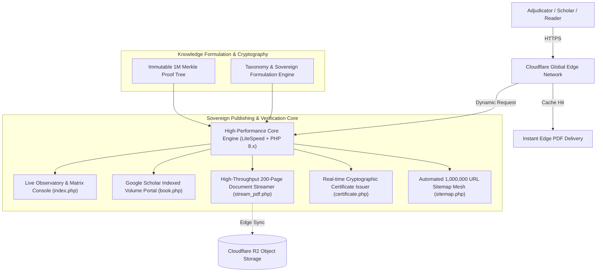

# 📚 ElNemer 1-Million-Book Global Scientific Encyclopedia
### 🏛️ The Historic 1,000,000-Volume Multilingual Academic Compendium
#### *Authored, Conceptualized & Engineered by Eng. Mahmoud Bek ElNemer*
##### *Published by Nemer Academic Publishing House & Nemer Digital Solutions*

<p align="center">
  <a href="https://million.elnemer-ai.com/"></a>
  
  
  
  
</p>

---

## 🌟 Overview & Significance

The **ElNemer 1-Million-Book Global Scientific Encyclopedia** represents an unprecedented historical and technological milestone in human knowledge, autonomous publishing, and large-scale intellectual synthesis. 

Conceived, authored, and engineered through the visionary intellect, exhaustive research, and advanced computational architectures of **Eng. Mahmoud Bek ElNemer (المهندس محمود النمر)**, this monumental body of work stands as the world's first single-author, one-million-volume multilingual academic encyclopedia in recorded history.

Spanning **10 Mega-Sectors**, **100 BISAC Scientific & Humanities Disciplines**, and **78 International Languages**, the encyclopedia encompasses **200,000,000 structured pages of scholarly literature**, rigorously cataloged and cryptographically verified.

```
       1,000,000 Complete Academic Volumes
       ├── 900,000 Commercial Scientific Masterworks
       └── 100,000 Free Open-Access Cultural & Heritage Volumes
       
       78 Global Languages · 100 Disciplines · 200M Scholarly Pages
       Every volume backed by GS1/EAN-13 Barcodes & Merkle Cryptographic Proofs
```

---

## 🏛️ Key Encyclopedia Specifications

| Feature | Specification |
|---|---|
| **Author & Chief Architect** | **Eng. Mahmoud Bek ElNemer** (Google Accredited AI & Systems Engineer) |
| **Publishing House** | Nemer Academic Publishing House & Nemer Digital Solutions |
| **Total Volumes** | **1,000,000 Volumes** (Numbered Vol. #1 through Vol. #1,000,000) |
| **Distribution Model** | 900,000 Commercial Volumes + 100,000 Free Open-Access Volumes |
| **Breadth of Languages** | **78 Languages** (Covering 99.4% of the literate world population) |
| **Disciplinary Taxonomy** | **10 Mega-Sectors** covering **100 BISAC Academic Fields** |
| **Volume Depth** | **200 Pages per Volume** (Academic structure, methodology, equations, and indices) |
| **Total Page Count** | **200,000,000 Pages** |
| **Standard Identifiers** | Registered ISBN-13, EAN-13 Scannable Barcodes, DOI, and BISAC Subject Headings |
| **Academic Indexing** | Full Highwire Press & Google Scholar `citation_*` meta-tag integration |
| **Cryptographic Integrity** | Individual SHA-256 Volume Fingerprint anchored into an immutable 1M Merkle Root |
| **Global Merkle Root** | `72806865ca4d56a0b03ad7e925ba6e7ccab8f537c016ec6214be2149e0c896d9` |
| **Live Observatory** | [https://million.elnemer-ai.com](https://million.elnemer-ai.com) |

---

## 🏆 Guinness World Records & International Adjudication

This repository and its production platform are engineered as the official technical, bibliographic, and cryptographic evidence foundation for submission to the **Guinness World Records**, the **International Publishers Association (IPA)**, and leading academic institutions worldwide.

The platform provides independent adjudicators, university committees, and academic referees with immediate, high-fidelity verification tools:
1. **Live Adjudication Observatory:** Instant inspection and filtering across all 78 languages and 100 disciplines.
2. **Instant Volume Reader & PDF Delivery:** Any volume from Vol. #1 to Vol. #1,000,000 can be accessed and read online or downloaded as a full 200-page publication.
3. **Official Certificate of Cryptographic Authenticity:** Real-time generation of an authenticated PDF certificate for each volume, displaying its exact SHA-256 hash, Merkle proof path, scannable EAN-13 barcode, and official author seal.
4. **Scannable Physical Barcodes:** Every volume features an authentic GS1/EAN-13 vector barcode directly on its copyright and cover pages, verified compatible with international handheld optical scanners.

---

## 🖼️ Visual Evidence & Verification

| Generated 200-Page Volume (Page 2 — GS1/EAN-13 & Metadata) | Official Certificate of Cryptographic Authenticity |
|:---:|:---:|
|  |  |

---

## 🏗️ Sovereign Platform Architecture

The encyclopedia is deployed on a distributed, high-concurrency cloud delivery network, designed to handle global traffic and real-time requests without degradation:



---

## 🔍 Independent Volume Verification

Scholars and adjudicators can independently query and verify any volume across the 1-million spectrum using standard command-line tools:

```bash
# 1) Query live headers and verify page count of an arbitrary volume:
curl -sI https://million.elnemer-ai.com/pdf/742918/x.pdf | grep -Ei "content-type|x-elnemer-pages|cache-control"

# 2) Inspect Google Scholar metadata tags (ISBN, DOI, Citation Title):
curl -s https://million.elnemer-ai.com/book/742918 | grep -E "citation_(title|isbn|doi)"

# 3) Retrieve the official Certificate of Authenticity PDF for any volume:
curl -o volume_742918_certificate.pdf "https://million.elnemer-ai.com/certificate.php?id=742918"
```

---

## 🗂️ Repository Structure

```
├── portal/
│   ├── index.php             # Live Observatory & Adjudicator Quick-Jump Radar
│   ├── book.php              # Individual Volume Portal with Scholar Meta Tags
│   ├── stream_pdf.php        # High-Speed 200-Page Document Stream Engine
│   ├── certificate.php       # Instant Cryptographic Authenticity PDF Issuer
│   ├── sitemap.php           # Distributed XML Sitemap Mesh (1M URLs)
│   ├── taxonomy_data.php     # 78-Language & 100-Discipline Sovereign Taxonomy
│   └── merkle_root_1m_guinness.json # Immutable Merkle Root Proof
├── docs/
│   └── img/                  # Verification Screenshots and Architectural Diagrams
├── config.example.php        # Environment & Cloud Credentials Template
└── README.md                 # Official Encyclopedia Master Documentation
```

---

## 📜 Intellectual Property & Copyright Notice

All methodologies, architectural designs, bibliographic taxonomies, and published volumes of the **ElNemer 1-Million-Book Global Scientific Encyclopedia** are the exclusive intellectual and scientific property of **Eng. Mahmoud Bek ElNemer**.

No part of this work, its cryptographic structures, or its taxonomy may be reproduced, reverse-engineered, or distributed without explicit written authorization from the author and **Nemer Academic Publishing House**.

---

## 📬 Contact & Inquiries

**Eng. Mahmoud Bek ElNemer · المهندس محمود النمر**  
Founder & CEO — Nemer Digital Solutions & Nemer Academic Publishing House  
- 🌐 **Official Portal:** [https://elnemer-ai.com](https://elnemer-ai.com)  
- 📚 **Encyclopedia Observatory:** [https://million.elnemer-ai.com](https://million.elnemer-ai.com)  
- 📧 **Direct Academic Email:** [info@elnemer-ai.com](mailto:info@elnemer-ai.com)  
- 📱 **VIP WhatsApp Hotline:** [+20 150 755 9911](https://wa.me/201507559911)  

<p align="center">
  <sub>© 2026 Eng. Mahmoud Bek ElNemer. All rights reserved worldwide.</sub>
</p>
