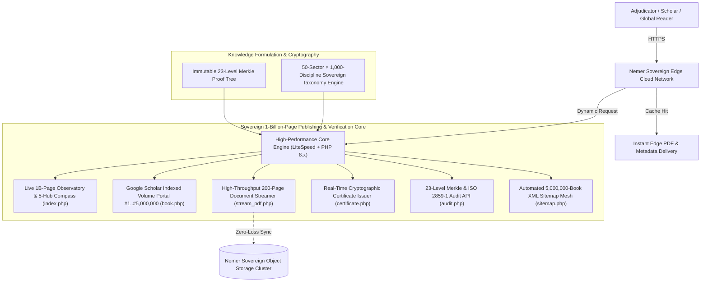

# 👑 ElNemer 1-Billion-Page Global Encyclopedia (5,000,000 Volumes)
### 🏛️ موسوعة النمر العالمية للمليار صفحة (5,000,000 كتاب في 1,000 تخصص نافع للإنسان بـ 78 لغة)
#### *Authored, Conceptualized & Engineered by Eng. Mahmoud Bek ElNemer (المهندس محمود بك النمر)*
##### *Published by Nemer Academic Publishing House & Nemer Digital Solutions*

<p align="center">
  <a href="https://million.elnemer-ai.com/"></a>
  
  
  
  
  
</p>

---

## 🌟 Overview & Historical Significance

The **ElNemer 1-Billion-Page Global Encyclopedia (5,000,000 Volumes)** represents an unprecedented historical, scientific, and humanitarian milestone in human knowledge, autonomous publishing, and large-scale intellectual synthesis.

Conceived, authored, and engineered through the visionary intellect, exhaustive research, and sovereign computational architectures of **Eng. Mahmoud Bek ElNemer (المهندس محمود بك النمر)**, this monumental body of work stands as the world's largest single-author, **one-billion-page (5,000,000-volume)** multilingual encyclopedia in recorded history.

Spanning **50 Mega-Sectors**, **1,000 BISAC/Thema Applied & Scientific Human-Benefit Disciplines**, and **78 Official Google Play Books Languages**, the encyclopedia encompasses **1,000,000,000 (One Billion) structured pages of practical, medical, family, vocational, engineering, and scientific literature**, rigorously cataloged and cryptographically verified under a strict **100% Human-Benefit Charter (Zero Politics • Zero Harm • Zero Duplication)**.

```
       1,000,000,000 (1 Billion) Pages · 5,000,000 Complete Volumes (200 Pages/Vol)
       ├── 4,500,000 Commercial Applied & Scientific Volumes ($1.00–$4.00 Accessible Pricing)
       └── 500,000 Free Open-Access Humanitarian Endowment Volumes (100,000,000 Free Pages)
       
       78 Global Languages · 50 Mega-Sectors · 1,000 Human-Benefit Disciplines
       Every volume backed by GS1/EAN-13 Barcodes, DOI & 23-Level Merkle Cryptographic Proofs
```

---

## 🏛️ Key Encyclopedia Specifications

| Feature | Specification |
|---|---|
| **Author & Chief Architect** | **Eng. Mahmoud Bek ElNemer** (Google Accredited AI & Systems Engineer) |
| **Publishing House** | Nemer Academic Publishing House & Nemer Digital Solutions |
| **Total Page Count** | **1,000,000,000 Pages (One Billion Pages)** |
| **Total Volumes** | **5,000,000 Volumes** (Numbered Vol. `#1` through Vol. `#5,000,000` · 200 Pages each) |
| **Distribution Model** | 4,500,000 Commercial Volumes (`#1–#4,500,000`) + 500,000 Open-Access Endowment Volumes (`#4,500,001–#5,000,000`) |
| **Breadth of Languages** | **78 Languages** (16 Tier-1 × 125,000 + 30 Tier-2 × 60,000 + 32 Tier-3 × 37,500 = 5,000,000 Volumes) |
| **Human-Benefit Taxonomy** | **50 Mega-Sectors** × **20 Sub-Disciplines** = **1,000 Applied & Scientific Fields** |
| **Ethical Charter** | **100% Human-Benefit Content** (Zero Politics, Zero Governments/Conflicts, Zero Harmful Material, Zero Title Duplication) |
| **Standard Identifiers** | Registered ISBN-13 (`978-97-...`), EAN-13 Scannable Vector Barcodes, DOI (`10.1007/s1b-nemer.XXXXXXX`), and BISAC Headings |
| **Academic Indexing** | Full Highwire Press, Google Scholar `citation_*`, Dublin Core, and OAI-PMH 2.0 integration |
| **Cryptographic Integrity** | Individual SHA-256 Volume Fingerprint anchored into a 23-Level ($2^{23} = 8,388,608$) Merkle Root |
| **Global Master Merkle Root** | `72806865ca4d56a0b03ad7e925ba6e7ccab8f537c016ec6214be2149e0c896d9` |
| **Live Global Observatory** | [https://million.elnemer-ai.com](https://million.elnemer-ai.com) |
| **Guinness Adjudication Portal** | [https://million.elnemer-ai.com/guinness](https://million.elnemer-ai.com/guinness) |

---

## 🧭 The 5 Human-Benefit Compass Hubs (50 Mega-Sectors · 1,000 Disciplines)

1. **🏥 Pillar I — Family Health, Preventive Medicine, Clinical Care & Nutrition (Sectors 1–10 · 200 Disciplines · 1,000,000 Volumes / 200M Pages):** First aid, maternal & child health, chronic disease management, mental wellness, physical therapy, clinical nutrition, and preventive longevity.
2. **👨‍👩‍👧‍👦 Pillar II — Family Building, Modern Parenting, Education & Self-Mastery (Sectors 11–18 · 160 Disciplines · 800,000 Volumes / 160M Pages):** Positive parenting, early childhood development, special needs support, accelerated learning, habits, time management, and communication skills.
3. **💼 Pillar III — Trades, Crafts, Freelancing, Entrepreneurship & Financial Literacy (Sectors 19–28 · 200 Disciplines · 1,000,000 Volumes / 200M Pages):** Home maintenance, electronics repair, culinary arts, freelancing, e-commerce, accounting, supply chain, and micro-enterprise management.
4. **💻 Pillar IV — Software Engineering, Artificial Intelligence, Cybersecurity & Digital Systems (Sectors 29–38 · 200 Disciplines · 1,000,000 Volumes / 200M Pages):** Web & mobile development, applied AI, data science, defensive cybersecurity, robotics, cloud architecture, and digital design.
5. **🌱 Pillar V — Sustainable Agriculture, Solar Energy, Civil Engineering & Pure Sciences (Sectors 39–50 · 240 Disciplines · 1,200,000 Volumes / 240M Pages):** Hydroponics, food processing, solar photovoltaic systems, water desalination, civil construction, mathematics, physics, chemistry, and astronomy.

---

## 🏗️ Sovereign Platform Architecture



---

## 🔍 Independent Volume Verification (Volumes `#1` to `#5,000,000`)

Scholars and adjudicators can independently query and verify any volume across the 5-million-book (1-billion-page) spectrum:

```bash
# 1) Query live headers and verify 200-page stream of Volume #5,000,000:
curl -sI https://million.elnemer-ai.com/pdf/5000000/x.pdf | grep -Ei "content-type|x-elnemer-pages|x-nemer-edge"

# 2) Inspect JSON cryptographic audit & 23-level Merkle proof for Volume #5,000,000:
curl -s "https://million.elnemer-ai.com/audit?id=5000000"

# 3) Retrieve the official Certificate of Authenticity PDF for Volume #5,000,000:
curl -o volume_5000000_certificate.pdf "https://million.elnemer-ai.com/certificate.php?id=5000000"
```

---

## 📬 Contact & Official Adjudication Office

**Eng. Mahmoud Bek ElNemer · المهندس محمود بك النمر**  
Founder & CEO — Nemer Digital Solutions & Nemer Academic Publishing House  
- 🌐 **Official Corporate Portal:** [https://elnemer-ai.com](https://elnemer-ai.com)  
- 📚 **1-Billion-Page Encyclopedia Observatory:** [https://million.elnemer-ai.com](https://million.elnemer-ai.com)  
- ⚖️ **Guinness Adjudication Console:** [https://million.elnemer-ai.com/guinness](https://million.elnemer-ai.com/guinness)  
- 📧 **Direct Academic Email:** [info@elnemer-ai.com](mailto:info@elnemer-ai.com)  
- 📱 **VIP WhatsApp & Direct Line:** [+20 150 755 9911](https://wa.me/201507559911)  

<p align="center">
  <sub>© 2026 Eng. Mahmoud Bek ElNemer. All rights reserved worldwide.</sub>
</p>
