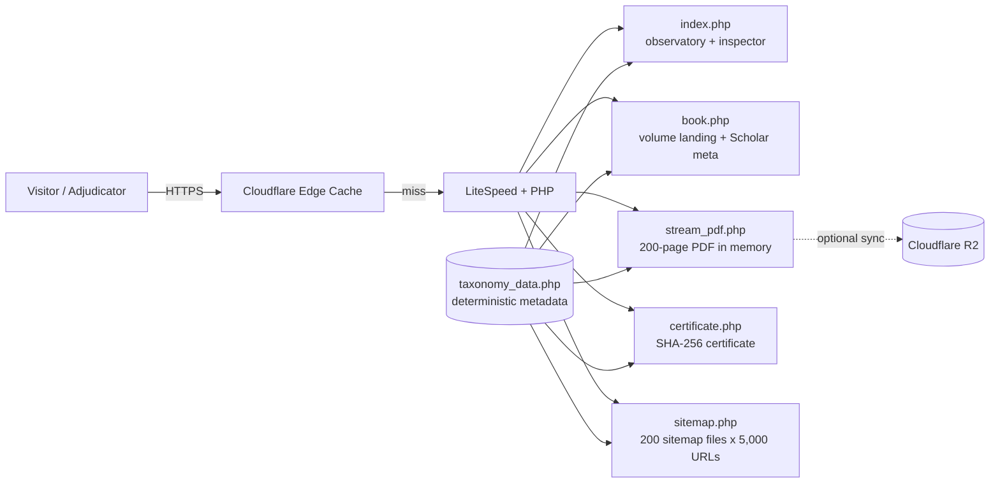

# 📚 ElNemer 1-Million-Book Global Encyclopedia

<p align="center">
  <b>A single-author, 1,000,000-volume multilingual scientific encyclopedia — generated, indexed and verifiable on demand.</b><br/>
  <i>By <a href="https://github.com/ElNeMeR70">Eng. Mahmoud Bek ElNemer</a> · Nemer Digital Solutions &amp; Nemer Academic Publishing House</i>
</p>

<p align="center">
  <a href="https://million.elnemer-ai.com/"></a>
  
  
  
  
  
</p>

---

## ✨ What is this?

Every one of the **1,000,000 volumes** has its own ISBN-13, DOI, BISAC subject, language (one of **78**), price tier and
SHA-256 fingerprint. Nothing is pre-rendered and stored: a volume's full **200-page PDF is synthesised in memory on request
(~0.3 s, 0 bytes on disk)** and then cached forever at the Cloudflare edge.

| | |
|---|---|
| 📖 Volumes | 1,000,000 (900,000 commercial · 100,000 free open-access) |
| 🌍 Languages | 78 (Google Play Books language set) |
| 🏛️ Taxonomy | 10 mega-sectors · 100 BISAC disciplines |
| 📄 Pages per volume | 200, each with a distinct text hash (200/200 unique on sampled volumes) |
| 🔐 Integrity | SHA-256 leaf per volume → Merkle tree → published root |
| ☁️ Delivery | Instant PDF streamer + `Cache-Control: public, max-age=31536000, immutable` |

**Merkle root:** `72806865ca4d56a0b03ad7e925ba6e7ccab8f537c016ec6214be2149e0c896d9`
([`merkle_root_1m_guinness.json`](portal/merkle_root_1m_guinness.json))

---

## 🖼️ Screenshots

| Generated PDF — page 2 (with scannable EAN-13) | Certificate of Cryptographic Authenticity |
|---|---|
|  |  |

---

## 🏗️ Architecture



### Routes

| Route | Purpose |
|---|---|
| `/` | Observatory: filters, 78-language matrix, random-sample inspector |
| `/book/{id}` | Volume landing page (Highwire Press / Google Scholar `citation_*` meta, hreflang, JSON-LD) |
| `/pdf/{id}/{name}.pdf` | Instant 200-page PDF |
| `/certificate.php?id={id}` | Per-volume certificate PDF (SHA-256 + Merkle root + EAN-13) |
| `/sitemap_index.xml` | 200 child sitemaps covering all 1,000,000 volumes |

---

## 🔎 Verify any volume yourself

```bash
# 1) Headers + page count of a random volume
curl -sI https://million.elnemer-ai.com/pdf/742918/x.pdf | grep -Ei "content-type|x-elnemer-pages|cache-control"

# 2) Landing page metadata (ISBN, DOI, Scholar tags)
curl -s https://million.elnemer-ai.com/book/742918 | grep -E "citation_(title|isbn|doi)"

# 3) Download its certificate
curl -o cert.pdf "https://million.elnemer-ai.com/certificate.php?id=742918"
```

---

## 🧱 Repository layout

```
portal/            PHP application (deployed to million.elnemer-ai.com)
docs/img/          screenshots used in this README
config.example.php how to supply Cloudflare R2 credentials (never commit real keys)
```

### Configuration

Secrets are **not** stored in this repository. Copy `config.example.php` to `portal/config.local.php`
(git-ignored) or export the environment variables `CF_R2_ACCOUNT_ID`, `CF_R2_ACCESS_KEY`, `CF_R2_SECRET_KEY`.

---

## ⚖️ Notes on scope

Volumes are produced by a deterministic combinatorial synthesiser: structure, taxonomy, identifiers and
cryptographic proofs are exact; body text is template-generated academic-format content. This project is
published as a technical and bibliographic record and is **prepared for** independent adjudication — it is
not itself an award or a certification by any third party.

## 📬 Contact

**Eng. Mahmoud Bek ElNemer** · [elnemer-ai.com](https://elnemer-ai.com) · info@elnemer-ai.com · WhatsApp +20 150 755 9911

© 2026 Eng. Mahmoud Bek ElNemer. All rights reserved.
