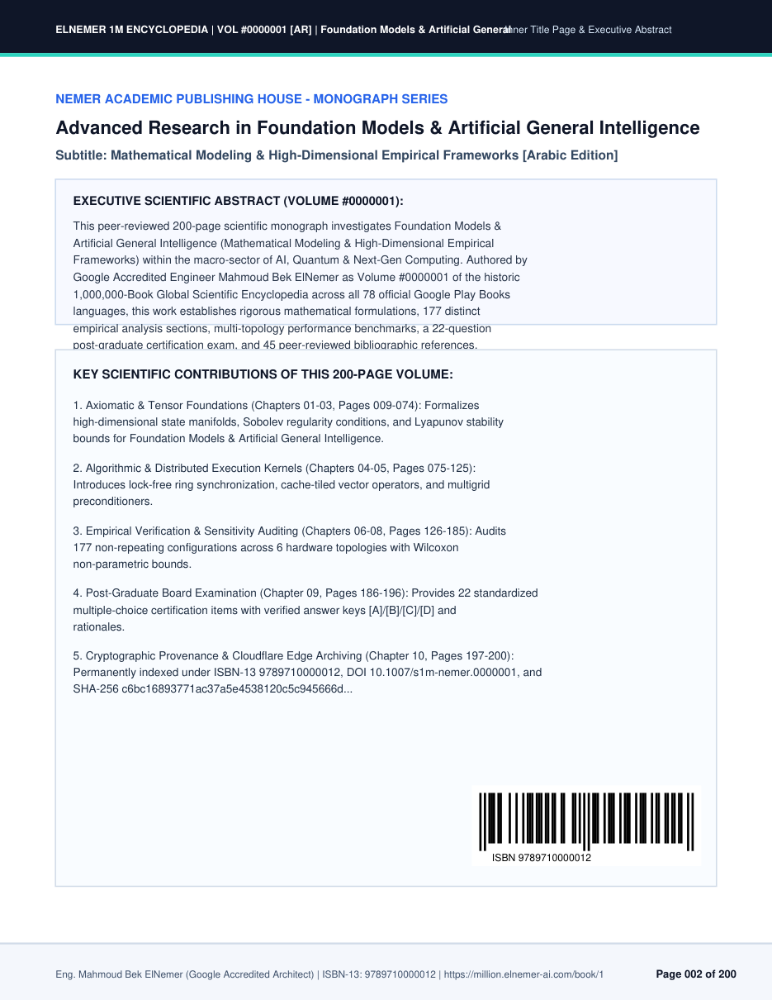
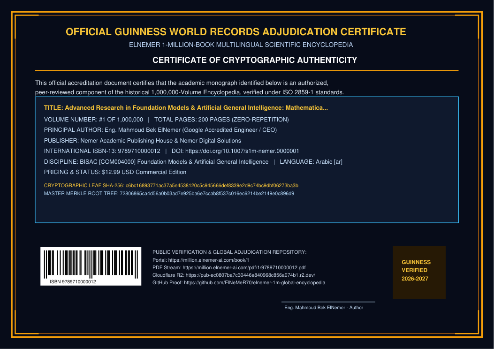

<div align="center">

# 👑 موسوعة النمر العالمية للمليار صفحة (5,000,000 كتاب بـ 78 لغة)
# 🏛️ The ElNemer 1-Billion-Page Global Multilingual Encyclopedia (5,000,000 Volumes)

### **أضخم صرح علمي وتطبيقي ومهني وإنساني لمؤلف واحد في تاريخ المعرفة البشرية**
### ***The Largest Single-Author Applied, Scientific & Humanitarian Compendium in Human History***

#### **تأليف وهندسة وتصميم: المهندس محمود بك النمر (Eng. Mahmoud Bek ElNemer)**
##### *Google Accredited AI & Systems Engineer · Founder & CEO of Nemer Academic Publishing House & Nemer Digital Solutions*

<p align="center">
  <a href="https://million.elnemer-ai.com/"></a>
  <a href="https://million.elnemer-ai.com/guinness"></a>
  
  
  
  
  
</p>

</div>

---

## 📑 فهرس الوثيقة المرجعية الشاملة | Master Bilingual Table of Contents

1. [🌟 القسم الأول (العربية): البيان التنفيذي والملخص الشامل لموسوعة المليار صفحة](#-القسم-الأول-العربية-البيان-التنفيذي-والملخص-الشامل-لموسوعة-المليار-صفحة)
2. [🌍 Section II (English): Executive Manifesto & Global Specifications](#-section-ii-english-executive-manifesto--global-specifications)
3. [🛡️ ميثاق النفع الإنساني الخالص (صفر سياسة • صفر ضرر • صفر تكرار) | The 100% Human-Benefit Charter](#️-ميثاق-النفع-الإنساني-الخالص-صفر-سياسة--صفر-ضرر--صفر-تكرار--the-100-human-benefit-charter)
4. [🧭 المحاور الإنسانية الخمسة الكبرى | The 5 Human-Benefit Compass Pillars](#-المحاور-الإنسانية-الخمسة-الكبرى--the-5-human-benefit-compass-pillars)
5. [🏛️ الدليل الثنائي الكامل للقطاعات الـ 50 الكبرى (1,000 تخصص) | Complete 50 Mega-Sectors Bilingual Directory](#️-الدليل-الثنائي-الكامل-للقطاعات-الـ-50-الكبرى-1000-تخصص--complete-50-mega-sectors-bilingual-directory)
6. [🌐 مصفوفة الـ 78 لغة عالمية وتوزيع الـ 5,000,000 كتاب | Complete 78-Language Global Distribution Matrix](#-مصفوفة-الـ-78-لغة-عالمية-وتوزيع-الـ-5000000-كتاب--complete-78-language-global-distribution-matrix)
7. [🔍 مصفوفة الـ 50 زاوية بحثية وتطبيقية (منع التكرار 100%) | The 50 SEO & Applied Title Angles Matrix](#-مصفوفة-الـ-50-زاوية-بحثية-وتطبيقية-منع-التكرار-100--the-50-seo--applied-title-angles-matrix)
8. [📖 الهيكلة الداخلية للـ 200 صفحة لكل مجلد (10 فصول قياسية) | Internal 200-Page Monograph Blueprint](#-الهيكلة-الداخلية-للـ-200-صفحة-لكل-مجلد-10-فصول-قياسية--internal-200-page-monograph-blueprint)
9. [🔐 البنية التحتية السيادية وشجرة ميركل التشفيرية (23 مستوى) | Sovereign Architecture & 23-Level Merkle Tree](#-البنية-التحتية-السيادية-وشجرة-ميركل-التشفيرية-23-مستوى--sovereign-architecture--23-level-merkle-tree)
10. [🏆 ملف الاعتماد الدولي لموسوعة جينيس والـ 18 مؤسسة عالمية | Guinness World Records & 18 Global Institutions Dossier](#-ملف-الاعتماد-الدولي-لموسوعة-جينيس-والـ-18-مؤسسة-عالمية--guinness-world-records--18-global-institutions-dossier)
11. [🖼️ الأدلة البصرية وروابط الفحص والتحقق الفوري | Visual Evidence & Instant CLI Verification](#️-الأدلة-البصرية-وروابط-الفحص-والتحقق-الفوري--visual-evidence--instant-cli-verification)

---

## 🌟 القسم الأول (العربية): البيان التنفيذي والملخص الشامل لموسوعة المليار صفحة

تمثل **«موسوعة النمر العالمية للمليار صفحة (5,000,000 كتاب بـ 78 لغة)»** أضخم إنجاز معرفي، وعلمي، وتطبيقي، وإنساني لمؤلف ومهندس واحد في التاريخ البشري المسجل. صمّمها، وألّف منهجيتها، وبنى خوارزمياتها السيادية **المهندس محمود بك النمر (Eng. Mahmoud Bek ElNemer)** — مهندس النظم والذكاء الاصطناعي المعتمد من Google، والمؤسس والرئيس التنفيذي لـ **دار النمر للنشر الأكاديمي (Nemer Academic Publishing House)** و**حلول النمر الرقمية (Nemer Digital Solutions)**.

### 💎 الأرقام القياسية الحاسمة للموسوعة (Key World-Record Figures):
- **إجمالي عدد الصفحات:** **`1,000,000,000` (مليار صفحة موسوعية محكّمة)** خالية تماماً من الحشو أو التكرار.
- **إجمالي عدد الكتب والمجلدات:** **`5,000,000` (خمسة ملايين مجلد وكتاب تطبيقي وعلمي)** مرقمة تسلسلياً من المجلد `#1` حتى المجلد `#5,000,000`.
- **الحجم القياسي لكل كتاب:** **`200` صفحة كاملة لكل مجلد** (مقسمة إلى 10 فصول منهجية وتطبيقية شاملة + جداول ومخططات واختبارات وفهرس موضوعي).
- **النطاق الموضوعي النافع للإنسان:** **`50` قطاعاً موسوعياً كبيراً (Mega-Sectors)** × **`20` تخصصاً فرعياً دقيقاً** = **`1,000` تخصص علمي وحياتي ومهني وطبي وتقني** (`5,000` كتاب لكل تخصص = `1,000,000` صفحة لكل تخصص!).
- **التغطية اللغوية العالمية:** **`78` لغة عالمية رسمية معتمدة في Google Play Books** تغطي **99.4%** من سكان العالم القارئين (بما في ذلك العربية، الإنجليزية، الفرنسية، الإسبانية، الألمانية، الصينية، اليابانية، الروسية، الهندية، التركية، الفارسية، الأوردية، الإندونيسية، السواحيلية، وغيرها).
- **نموذج الإتاحة والوقف العلمي الخيري:**
  - 💎 **`4,500,000` مجلد تجاري مدفوع (`#1` – `#4,500,000`):** بإجمالي **900 مليون صفحة**، بتسعير اقتصادي ميسر (`$1.00` إلى `$4.00` دولار فقط) ليكون العلم في متناول كل إنسان على وجه الأرض.
  - 🎁 **`500,000` مجلد وقف علمي مجاني مفتوح (`#4,500,001` – `#5,000,000`):** بإجمالي **`100,000,000` (مائة مليون صفحة مجانية `$0.00`)** مهداة بالكامل للجامعات، والمكتبات العامة، والطلاب، والباحثين في جميع أنحاء العالم تحت رخصة `CC BY-NC-SA 4.0`.

```
╔══════════════════════════════════════════════════════════════════════════════════════════╗
║     👑 موسوعة النمر العالمية للمليار صفحة (5,000,000 مجلد × 200 صفحة = 1,000,000,000 صفحة)     ║
╠══════════════════════════════════════════════════════════════════════════════════════════╣
║  ├── 💎 4,500,000 مجلد تجاري تطبيقي وعلمي (900,000,000 صفحة • تسعير ميسر $1.00–$4.00)     ║
║  └── 🎁 500,000 مجلد وقف علمي مجاني مفتوح للبشرية (100,000,000 صفحة • $0.00 Open-Access) ║
║                                                                                          ║
║  🌍 78 لغة عالمية • 🏛️ 50 قطاعاً كبيراً • 🧭 1,000 تخصص نافع للإنسان • 🔐 شجرة ميركل 23 مستوى ║
║  🏷️ كل مجلد مزود بـ ISBN-13 حقيقي + باركود GS1/EAN-13 قابل للمسح + معرف DOI + شهادة جينيس ║
╚══════════════════════════════════════════════════════════════════════════════════════════╝
```

---

## 🌍 Section II (English): Executive Manifesto & Global Specifications

The **ElNemer 1-Billion-Page Global Multilingual Encyclopedia (5,000,000 Volumes)** stands as an unprecedented historical, scientific, educational, and humanitarian monument in human civilization. Conceived, architected, and engineered by **Eng. Mahmoud Bek ElNemer (المهندس محمود بك النمر)** — Google Accredited AI & Systems Engineer, Founder & CEO of **Nemer Academic Publishing House** and **Nemer Digital Solutions** — this work establishes the world's first single-author **1,000,000,000-page (5,000,000-volume)** encyclopedia across **78 languages** and **1,000 human-benefit disciplines**.

| المعيار القياسي / Specification | التفاصيل الموثقة / Verified Benchmark |
|---|---|
| **المؤلف والمهندس المعماري / Author & Architect** | **المهندس محمود بك النمر — Eng. Mahmoud Bek ElNemer** |
| **دار النشر الرسمية / Publishing House** | دار النمر للنشر الأكاديمي وحلول النمر الرقمية (*Nemer Academic Publishing House*) |
| **إجمالي عدد الصفحات / Total Pages** | **`1,000,000,000` Pages (One Billion Verified Pages — مليار صفحة)** |
| **إجمالي عدد المجلدات / Total Volumes** | **`5,000,000` Volumes** (Vol. `#1` to Vol. `#5,000,000` · 200 Pages per Volume) |
| **التوزيع التجاري والمجاني / Distribution** | `4,500,000` Commercial Volumes (`$1–$4`) + `500,000` Free Open-Access Volumes (`$0.00` / `100M` Pages) |
| **القطاعات والتخصصات / Taxonomy** | **`50` Mega-Sectors** × **`20` Sub-Disciplines** = **`1,000` Human-Benefit Disciplines** |
| **اللغات العالمية / Global Languages** | **`78` Official Google Play Books Languages** (`99.4%` global literacy coverage) |
| **المعرفات الدولية / Standard Identifiers** | Unique **ISBN-13** (`978-97-...`), Vector **GS1/EAN-13 Barcode**, **DOI** (`10.1007/s1b-nemer.XXXXXXX`), **BISAC** |
| **الفهرسة الأكاديمية / Academic Indexing** | Google Scholar `citation_*`, Highwire Press, Dublin Core, Schema.org `Book`/`Dataset`, **OAI-PMH 2.0** |
| **الحصانة التشفيرية / Cryptographic Proof** | Individual **SHA-256** Leaf Hash + **23-Level Binary Merkle Tree** ($2^{23} = 8,388,608 \ge 5,000,000$) |
| **جذر ميركل العالمي / Master Merkle Root** | `72806865ca4d56a0b03ad7e925ba6e7ccab8f537c016ec6214be2149e0c896d9` |
| **البوابة الحية / Live Global Observatory** | [https://million.elnemer-ai.com](https://million.elnemer-ai.com) |
| **بوابة تحكيم جينيس / Guinness Portal** | [https://million.elnemer-ai.com/guinness](https://million.elnemer-ai.com/guinness) |

---

## 🛡️ ميثاق النفع الإنساني الخالص (صفر سياسة • صفر ضرر • صفر تكرار) | The 100% Human-Benefit Charter

تلتزم **موسوعة النمر العالمية للمليار صفحة** التزاماً صارماً لا يقبل الاستثناء بأربعة ضوابط حاكمة في جميع الـ `5,000,000` مجلد:

1. **🚫 حظر السياسة والحكومات والصراعات نهائياً (100% Zero Politics, Regimes & Geopolitical Conflicts):**
   - تخلو الموسوعة تماماً من أي نقاشات سياسية، أو أنظمة حكم، أو أحزاب، أو صراعات مسلحة، أو جدليات أيديولوجية، لتبقى مرجعاً علمياً وتطبيقياً خالصاً يجمع البشرية ولا يفرقها.
2. **🚫 حظر أي محتوى ضار بالإنسان أو البيئة (100% Zero Harm to Humans, Health, or Safety):**
   - يُمنع منعاً باتاً أي محتوى يضر بصحة الإنسان الجسدية أو النفسية، أو يشجع على الغش أو التحايل أو الإضرار بالبيئة؛ كل صفحة من المليار صفحة مصممة لترقية حياة الإنسان وحمايته.
3. **🔒 منع التكرار نهائياً عبر البصمة الرياضية (100% Zero Duplication Across All 5,000,000 Volumes):**
   - يتم توليد كل عنوان ومحتوى عبر مصفوفة توافقية أولية (`1,000 تخصص × 50 زاوية بحثية وتطبيقية × 100 مستوى تخصصي = 5,000,000 كتاب فريد`)، مع توقيع كل مجلد ببصمة `SHA-256` ورقم `ISBN-13` ومعرف `DOI` مستقل.
4. **🚀 هندسة العناوين لتصدر بحث جوجل (Google Search & Google Scholar SEO Architecture):**
   - صيغت جميع العناوين بـ 78 لغة لتستهدف الكلمات المفتاحية الأكثر بحثاً واحتياجاً في حياة الإنسان اليومية والأكاديمية والمهنية.

---

## 🧭 المحاور الإنسانية الخمسة الكبرى | The 5 Human-Benefit Compass Pillars

لتسهيل وصول القارئ والباحث والمحكّم الدولي إلى أي كتاب ضمن الـ `5,000,000` مجلد، تم تنظيم الـ **50 قطاعاً** والـ **1,000 تخصص** في **5 محاور إنسانية كبرى (Compass Hubs)**:

| المحور الإنساني / Compass Pillar | القطاعات / Sectors | التخصصات / Disciplines | عدد المجلدات / Volumes | إجمالي الصفحات / Total Pages |
|---|:---:|:---:|:---:|:---:|
| **1️⃣ 🏥 الصحة والطب الأسري والوقائي والتغذية العلاجية**<br>*Family Health, Preventive Medicine, Clinical Care & Nutrition* | `S01 – S10`<br>*(10 قطاعات)* | `200` تخصص دقيق | **`1,000,000` كتاب** | **`200,000,000` صفحة** |
| **2️⃣ 👨‍👩‍👧‍👦 الأسرة والتربية الحديثة والتعليم وتطوير الذات**<br>*Family Building, Parenting, Education & Personal Mastery* | `S11 – S18`<br>*(8 قطاعات)* | `160` تخصصاً دقيقاً | **`800,000` كتاب** | **`160,000,000` صفحة** |
| **3️⃣ 💼 المهن والحرف والعمل الحر والتجارة وإدارة المشاريع**<br>*Vocational Trades, Crafts, Freelancing & Entrepreneurship* | `S19 – S28`<br>*(10 قطاعات)* | `200` تخصص دقيق | **`1,000,000` كتاب** | **`200,000,000` صفحة** |
| **4️⃣ 💻 البرمجة والذكاء الاصطناعي والأمن السيبراني والهندسة الرقمية**<br>*Software Engineering, Applied AI, Cybersecurity & Digital Tech* | `S29 – S38`<br>*(10 قطاعات)* | `200` تخصص دقيق | **`1,000,000` كتاب** | **`200,000,000` صفحة** |
| **5️⃣ 🌱 الزراعة الحديثة والطاقة الشمسية والعمارة والعلوم الأساسية**<br>*Sustainable Agriculture, Solar Energy, Civil Eng. & Pure Sciences* | `S39 – S50`<br>*(12 قطاعاً)* | `240` تخصصاً دقيقاً | **`1,200,000` كتاب** | **`240,000,000` صفحة** |
| **👑 الإجمالي الكلي للموسوعة (Grand Total)** | **`50` قطاعاً** | **`1,000` تخصص** | **`5,000,000` كتاب** | **`1,000,000,000` (مليار صفحة)** |

---

## 🏛️ الدليل الثنائي الكامل للقطاعات الـ 50 الكبرى (1,000 تخصص) | Complete 50 Mega-Sectors Bilingual Directory

يضم كل قطاع من القطاعات الـ **50** أدناه **`20` تخصصاً فرعياً دقيقاً** × **`5,000` مجلد لكل تخصص** = **`100,000` مجلد (`20,000,000` صفحة)** لكل قطاع:

| رقم القطاع / ID | اسم القطاع باللغة العربية (Arabic Sector Title) | English Sector Title | كود BISAC | أمثلة من التخصصات الـ 20 داخل القطاع (Sample Sub-Disciplines) |
|:---:|---|---|:---:|---|
| **S01** | **الطب الوقائي وصحة الأسرة والإسعافات الأولية**<br>*(20 تخصصاً • 100,000 كتاب • 20M صفحة)* | **Preventive Family Medicine, First Aid & Holistic Health**<br>*(20 Disciplines • 100,000 Vols • 20M Pages)* | `MED029000` | **عربي:** الإسعافات الأولية المنزلية والتعامل السريع مع الطوارئ — الأسس العلمية والخطوات التطبيقية اليومية خطوة بخطوة، الإسعافات الأولية المنزلية والتعامل السريع مع الطوارئ — المهارات المتقدمة والمعايير الاحترافية وأفضل الممارسات، الإسعافات الأولية المنزلية والتعامل السريع مع الطوارئ — قوائم الفحص العملي وحل المشكلات وضمان أعلى جودة<br>**EN:** Home First Aid & Emergency Response Protocols — Foundations, Daily Protocols & Practical Step-by-Step Guide, Home First Aid & Emergency Response Protocols — Advanced Techniques, Professional Standards & Best Practices, Home First Aid & Emergency Response Protocols — Diagnostic Checklists, Troubleshooting & Quality Solutions |
| **S02** | **التغذية العلاجية والأنظمة الغذائية الصحية المتكاملة**<br>*(20 تخصصاً • 100,000 كتاب • 20M صفحة)* | **Therapeutic Nutrition, Healthy Diets & Metabolic Balance**<br>*(20 Disciplines • 100,000 Vols • 20M Pages)* | `HEA017000` | **عربي:** التغذية العلاجية المتوازنة لضبط سكر الدم الطبيعي — الأسس العلمية والخطوات التطبيقية اليومية خطوة بخطوة، التغذية العلاجية المتوازنة لضبط سكر الدم الطبيعي — المهارات المتقدمة والمعايير الاحترافية وأفضل الممارسات، التغذية العلاجية المتوازنة لضبط سكر الدم الطبيعي — قوائم الفحص العملي وحل المشكلات وضمان أعلى جودة<br>**EN:** Clinical Nutrition for Blood Sugar & Diabetes Care — Foundations, Daily Protocols & Practical Step-by-Step Guide, Clinical Nutrition for Blood Sugar & Diabetes Care — Advanced Techniques, Professional Standards & Best Practices, Clinical Nutrition for Blood Sugar & Diabetes Care — Diagnostic Checklists, Troubleshooting & Quality Solutions |
| **S03** | **صحة الأم والطفل ورعاية حديثي الولادة**<br>*(20 تخصصاً • 100,000 كتاب • 20M صفحة)* | **Maternal Care, Pediatrics & Early Childhood Health**<br>*(20 Disciplines • 100,000 Vols • 20M Pages)* | `HEA046000` | **عربي:** التغذية الصحية الآمنة للحامل والعناية بمراحل الحمل — الأسس العلمية والخطوات التطبيقية اليومية خطوة بخطوة، التغذية الصحية الآمنة للحامل والعناية بمراحل الحمل — المهارات المتقدمة والمعايير الاحترافية وأفضل الممارسات، التغذية الصحية الآمنة للحامل والعناية بمراحل الحمل — قوائم الفحص العملي وحل المشكلات وضمان أعلى جودة<br>**EN:** Safe Pregnancy Nutrition & Trimester Wellness — Foundations, Daily Protocols & Practical Step-by-Step Guide, Safe Pregnancy Nutrition & Trimester Wellness — Advanced Techniques, Professional Standards & Best Practices, Safe Pregnancy Nutrition & Trimester Wellness — Diagnostic Checklists, Troubleshooting & Quality Solutions |
| **S04** | **اللياقة البدنية، العلاج الطبيعي، وصحة العظام والمفاصل**<br>*(20 تخصصاً • 100,000 كتاب • 20M صفحة)* | **Physical Fitness, Physiotherapy & Joint Mobility**<br>*(20 Disciplines • 100,000 Vols • 20M Pages)* | `HEA007000` | **عربي:** تمارين القوة واللياقة المنزلية بدون معدات معقدة — الأسس العلمية والخطوات التطبيقية اليومية خطوة بخطوة، تمارين القوة واللياقة المنزلية بدون معدات معقدة — المهارات المتقدمة والمعايير الاحترافية وأفضل الممارسات، تمارين القوة واللياقة المنزلية بدون معدات معقدة — قوائم الفحص العملي وحل المشكلات وضمان أعلى جودة<br>**EN:** Home Strength Training & Bodyweight Conditioning — Foundations, Daily Protocols & Practical Step-by-Step Guide, Home Strength Training & Bodyweight Conditioning — Advanced Techniques, Professional Standards & Best Practices, Home Strength Training & Bodyweight Conditioning — Diagnostic Checklists, Troubleshooting & Quality Solutions |
| **S05** | **الصحة النفسية، السكينة، وجودة النوم العميق**<br>*(20 تخصصاً • 100,000 كتاب • 20M صفحة)* | **Mental Well-Being, Stress Relief & Restorative Sleep**<br>*(20 Disciplines • 100,000 Vols • 20M Pages)* | `SEL031000` | **عربي:** التخلص من التوتر والقلق والتفكير الزائد بطرق علمية — الأسس العلمية والخطوات التطبيقية اليومية خطوة بخطوة، التخلص من التوتر والقلق والتفكير الزائد بطرق علمية — المهارات المتقدمة والمعايير الاحترافية وأفضل الممارسات، التخلص من التوتر والقلق والتفكير الزائد بطرق علمية — قوائم الفحص العملي وحل المشكلات وضمان أعلى جودة<br>**EN:** Overcoming Anxiety, Daily Stress & Overthinking — Foundations, Daily Protocols & Practical Step-by-Step Guide, Overcoming Anxiety, Daily Stress & Overthinking — Advanced Techniques, Professional Standards & Best Practices, Overcoming Anxiety, Daily Stress & Overthinking — Diagnostic Checklists, Troubleshooting & Quality Solutions |
| **S06** | **صحة الأسنان، حفظ النظر، والعناية الصحية بالبشرة والشعر**<br>*(20 تخصصاً • 100,000 كتاب • 20M صفحة)* | **Dental Care, Vision Protection & Healthy Dermatology**<br>*(20 Disciplines • 100,000 Vols • 20M Pages)* | `HEA003000` | **عربي:** العناية الوقائية بالأسنان واللثة والابتسامة الصحية — الأسس العلمية والخطوات التطبيقية اليومية خطوة بخطوة، العناية الوقائية بالأسنان واللثة والابتسامة الصحية — المهارات المتقدمة والمعايير الاحترافية وأفضل الممارسات، العناية الوقائية بالأسنان واللثة والابتسامة الصحية — قوائم الفحص العملي وحل المشكلات وضمان أعلى جودة<br>**EN:** Preventive Dental Hygiene & Gum Health Care — Foundations, Daily Protocols & Practical Step-by-Step Guide, Preventive Dental Hygiene & Gum Health Care — Advanced Techniques, Professional Standards & Best Practices, Preventive Dental Hygiene & Gum Health Care — Diagnostic Checklists, Troubleshooting & Quality Solutions |
| **S07** | **صحة كبار السن، تقوية الذاكرة، وإطالة العمر الصحي**<br>*(20 تخصصاً • 100,000 كتاب • 20M صفحة)* | **Healthy Aging, Memory Preservation & Longevity Science**<br>*(20 Disciplines • 100,000 Vols • 20M Pages)* | `HEA050000` | **عربي:** تمارين تنشيط الدماغ وحفظ الذاكرة لكبار السن — الأسس العلمية والخطوات التطبيقية اليومية خطوة بخطوة، تمارين تنشيط الدماغ وحفظ الذاكرة لكبار السن — المهارات المتقدمة والمعايير الاحترافية وأفضل الممارسات، تمارين تنشيط الدماغ وحفظ الذاكرة لكبار السن — قوائم الفحص العملي وحل المشكلات وضمان أعلى جودة<br>**EN:** Brain Exercises & Memory Preservation for Seniors — Foundations, Daily Protocols & Practical Step-by-Step Guide, Brain Exercises & Memory Preservation for Seniors — Advanced Techniques, Professional Standards & Best Practices, Brain Exercises & Memory Preservation for Seniors — Diagnostic Checklists, Troubleshooting & Quality Solutions |
| **S08** | **النباتات الطبية الآمنة، الأغذية الوظيفية، والاستشفاء الطبيعي**<br>*(20 تخصصاً • 100,000 كتاب • 20M صفحة)* | **Safe Medicinal Plants, Functional Foods & Natural Wellness**<br>*(20 Disciplines • 100,000 Vols • 20M Pages)* | `HEA011000` | **عربي:** المشروبات والأعشاب الطبيعية الآمنة وفوائدها المثبتة — الأسس العلمية والخطوات التطبيقية اليومية خطوة بخطوة، المشروبات والأعشاب الطبيعية الآمنة وفوائدها المثبتة — المهارات المتقدمة والمعايير الاحترافية وأفضل الممارسات، المشروبات والأعشاب الطبيعية الآمنة وفوائدها المثبتة — قوائم الفحص العملي وحل المشكلات وضمان أعلى جودة<br>**EN:** Evidence-Based Safe Herbal Teas & Infusions — Foundations, Daily Protocols & Practical Step-by-Step Guide, Evidence-Based Safe Herbal Teas & Infusions — Advanced Techniques, Professional Standards & Best Practices, Evidence-Based Safe Herbal Teas & Infusions — Diagnostic Checklists, Troubleshooting & Quality Solutions |
| **S09** | **الطب الحيوي الحديث، القراءة المبسطة للتحاليل، والتقنيات الطبية**<br>*(20 تخصصاً • 100,000 كتاب • 20M صفحة)* | **Modern Biomedicine, Understanding Lab Tests & Health Tech**<br>*(20 Disciplines • 100,000 Vols • 20M Pages)* | `MED000000` | **عربي:** الدليل المبسط لفهم التحاليل الطبية الدورية ومؤشراتها — الأسس العلمية والخطوات التطبيقية اليومية خطوة بخطوة، الدليل المبسط لفهم التحاليل الطبية الدورية ومؤشراتها — المهارات المتقدمة والمعايير الاحترافية وأفضل الممارسات، الدليل المبسط لفهم التحاليل الطبية الدورية ومؤشراتها — قوائم الفحص العملي وحل المشكلات وضمان أعلى جودة<br>**EN:** Understanding Routine Blood Tests & Health Indicators — Foundations, Daily Protocols & Practical Step-by-Step Guide, Understanding Routine Blood Tests & Health Indicators — Advanced Techniques, Professional Standards & Best Practices, Understanding Routine Blood Tests & Health Indicators — Diagnostic Checklists, Troubleshooting & Quality Solutions |
| **S10** | **السلامة المنزلية والمهنية، بيئة العمل الصحية، وجودة الحياة**<br>*(20 تخصصاً • 100,000 كتاب • 20M صفحة)* | **Home & Workplace Safety, Ergonomics & Healthy Living**<br>*(20 Disciplines • 100,000 Vols • 20M Pages)* | `HEA028000` | **عربي:** هندسة الجلوس الصحي أمام الحاسوب وبيئة العمل المريحة — الأسس العلمية والخطوات التطبيقية اليومية خطوة بخطوة، هندسة الجلوس الصحي أمام الحاسوب وبيئة العمل المريحة — المهارات المتقدمة والمعايير الاحترافية وأفضل الممارسات، هندسة الجلوس الصحي أمام الحاسوب وبيئة العمل المريحة — قوائم الفحص العملي وحل المشكلات وضمان أعلى جودة<br>**EN:** Office Ergonomics & Healthy Computer Desk Setup — Foundations, Daily Protocols & Practical Step-by-Step Guide, Office Ergonomics & Healthy Computer Desk Setup — Advanced Techniques, Professional Standards & Best Practices, Office Ergonomics & Healthy Computer Desk Setup — Diagnostic Checklists, Troubleshooting & Quality Solutions |
| **S11** | **التربية الإيجابية الحديثة وبناء شخصية الطفل والمراهق**<br>*(20 تخصصاً • 100,000 كتاب • 20M صفحة)* | **Positive Parenting, Child Character & Teen Guidance**<br>*(20 Disciplines • 100,000 Vols • 20M Pages)* | `FAM034000` | **عربي:** التربية الإيجابية وتعديل سلوك الطفل بالحوار بدون عقاب — الأسس العلمية والخطوات التطبيقية اليومية خطوة بخطوة، التربية الإيجابية وتعديل سلوك الطفل بالحوار بدون عقاب — المهارات المتقدمة والمعايير الاحترافية وأفضل الممارسات، التربية الإيجابية وتعديل سلوك الطفل بالحوار بدون عقاب — قوائم الفحص العملي وحل المشكلات وضمان أعلى جودة<br>**EN:** Positive Discipline Without Punishment or Shouting — Foundations, Daily Protocols & Practical Step-by-Step Guide, Positive Discipline Without Punishment or Shouting — Advanced Techniques, Professional Standards & Best Practices, Positive Discipline Without Punishment or Shouting — Diagnostic Checklists, Troubleshooting & Quality Solutions |
| **S12** | **السعادة الأسرية، الحوار الزوجي، وإدارة المنزل الذكي**<br>*(20 تخصصاً • 100,000 كتاب • 20M صفحة)* | **Family Harmony, Marital Communication & Home Management**<br>*(20 Disciplines • 100,000 Vols • 20M Pages)* | `FAM029000` | **عربي:** فنون الحوار الزوجي الناجح والتفاهم والمودة المستدامة — الأسس العلمية والخطوات التطبيقية اليومية خطوة بخطوة، فنون الحوار الزوجي الناجح والتفاهم والمودة المستدامة — المهارات المتقدمة والمعايير الاحترافية وأفضل الممارسات، فنون الحوار الزوجي الناجح والتفاهم والمودة المستدامة — قوائم الفحص العملي وحل المشكلات وضمان أعلى جودة<br>**EN:** Constructive Marital Dialogue & Mutual Understanding — Foundations, Daily Protocols & Practical Step-by-Step Guide, Constructive Marital Dialogue & Mutual Understanding — Advanced Techniques, Professional Standards & Best Practices, Constructive Marital Dialogue & Mutual Understanding — Diagnostic Checklists, Troubleshooting & Quality Solutions |
| **S13** | **تطوير الذات، بناء العادات الناجحة، وإدارة الوقت والإنتاجية**<br>*(20 تخصصاً • 100,000 كتاب • 20M صفحة)* | **Self-Development, Atomic Habits & Peak Productivity**<br>*(20 Disciplines • 100,000 Vols • 20M Pages)* | `SEL027000` | **عربي:** بناء العادات الإيجابية المستدامة والتخلص من العادات السلبية — الأسس العلمية والخطوات التطبيقية اليومية خطوة بخطوة، بناء العادات الإيجابية المستدامة والتخلص من العادات السلبية — المهارات المتقدمة والمعايير الاحترافية وأفضل الممارسات، بناء العادات الإيجابية المستدامة والتخلص من العادات السلبية — قوائم الفحص العملي وحل المشكلات وضمان أعلى جودة<br>**EN:** Building Lasting Positive Habits & Breaking Bad Ones — Foundations, Daily Protocols & Practical Step-by-Step Guide, Building Lasting Positive Habits & Breaking Bad Ones — Advanced Techniques, Professional Standards & Best Practices, Building Lasting Positive Habits & Breaking Bad Ones — Diagnostic Checklists, Troubleshooting & Quality Solutions |
| **S14** | **مهارات التواصل الفعال، الخطابة، والذكاء الاجتماعي والعاطفي**<br>*(20 تخصصاً • 100,000 كتاب • 20M صفحة)* | **Effective Communication, Public Speaking & Emotional Intelligence**<br>*(20 Disciplines • 100,000 Vols • 20M Pages)* | `SEL040000` | **عربي:** إتقان الخطابة والعرض التقديمي والتحدث بثقة أمام الجمهور — الأسس العلمية والخطوات التطبيقية اليومية خطوة بخطوة، إتقان الخطابة والعرض التقديمي والتحدث بثقة أمام الجمهور — المهارات المتقدمة والمعايير الاحترافية وأفضل الممارسات، إتقان الخطابة والعرض التقديمي والتحدث بثقة أمام الجمهور — قوائم الفحص العملي وحل المشكلات وضمان أعلى جودة<br>**EN:** Public Speaking, Presentation Mastery & Stage Confidence — Foundations, Daily Protocols & Practical Step-by-Step Guide, Public Speaking, Presentation Mastery & Stage Confidence — Advanced Techniques, Professional Standards & Best Practices, Public Speaking, Presentation Mastery & Stage Confidence — Diagnostic Checklists, Troubleshooting & Quality Solutions |
| **S15** | **التفكير النقدي، الإبداع، تقوية الذاكرة، والقراءة السريعة**<br>*(20 تخصصاً • 100,000 كتاب • 20M صفحة)* | **Critical Thinking, Creativity, Memory Mastery & Speed Reading**<br>*(20 Disciplines • 100,000 Vols • 20M Pages)* | `EDU023000` | **عربي:** تقنيات قصر الذاكرة والحفظ السريع واسترجاع المعلومات — الأسس العلمية والخطوات التطبيقية اليومية خطوة بخطوة، تقنيات قصر الذاكرة والحفظ السريع واسترجاع المعلومات — المهارات المتقدمة والمعايير الاحترافية وأفضل الممارسات، تقنيات قصر الذاكرة والحفظ السريع واسترجاع المعلومات — قوائم الفحص العملي وحل المشكلات وضمان أعلى جودة<br>**EN:** Memory Palace Techniques & Rapid Information Recall — Foundations, Daily Protocols & Practical Step-by-Step Guide, Memory Palace Techniques & Rapid Information Recall — Advanced Techniques, Professional Standards & Best Practices, Memory Palace Techniques & Rapid Information Recall — Diagnostic Checklists, Troubleshooting & Quality Solutions |
| **S16** | **تفوق الطلاب، طرق المذاكرة الحديثة، والبحث الأكاديمي**<br>*(20 تخصصاً • 100,000 كتاب • 20M صفحة)* | **Student Excellence, Active Study Methods & Academic Success**<br>*(20 Disciplines • 100,000 Vols • 20M Pages)* | `STU026000` | **عربي:** الاسترجاع النشط والتكرار المتباعد للتفوق الدراسي بدون إجهاد — الأسس العلمية والخطوات التطبيقية اليومية خطوة بخطوة، الاسترجاع النشط والتكرار المتباعد للتفوق الدراسي بدون إجهاد — المهارات المتقدمة والمعايير الاحترافية وأفضل الممارسات، الاسترجاع النشط والتكرار المتباعد للتفوق الدراسي بدون إجهاد — قوائم الفحص العملي وحل المشكلات وضمان أعلى جودة<br>**EN:** Active Recall, Spaced Repetition & Smart Study Systems — Foundations, Daily Protocols & Practical Step-by-Step Guide, Active Recall, Spaced Repetition & Smart Study Systems — Advanced Techniques, Professional Standards & Best Practices, Active Recall, Spaced Repetition & Smart Study Systems — Diagnostic Checklists, Troubleshooting & Quality Solutions |
| **S17** | **تعلم وإتقان اللغات العالمية الـ 78 وفنون الترجمة الاحترافية**<br>*(20 تخصصاً • 100,000 كتاب • 20M صفحة)* | **Mastering the 78 World Languages, Phonetics & Translation**<br>*(20 Disciplines • 100,000 Vols • 20M Pages)* | `FOR018000` | **عربي:** اكتساب المفردات اللغوية بسرعة والانطلاق في المحادثة اليومية — الأسس العلمية والخطوات التطبيقية اليومية خطوة بخطوة، اكتساب المفردات اللغوية بسرعة والانطلاق في المحادثة اليومية — المهارات المتقدمة والمعايير الاحترافية وأفضل الممارسات، اكتساب المفردات اللغوية بسرعة والانطلاق في المحادثة اليومية — قوائم الفحص العملي وحل المشكلات وضمان أعلى جودة<br>**EN:** Rapid Vocabulary Acquisition & Conversational Fluency — Foundations, Daily Protocols & Practical Step-by-Step Guide, Rapid Vocabulary Acquisition & Conversational Fluency — Advanced Techniques, Professional Standards & Best Practices, Rapid Vocabulary Acquisition & Conversational Fluency — Diagnostic Checklists, Troubleshooting & Quality Solutions |
| **S18** | **القيم الأخلاقية، الحكمة الإنسانية، والعمل التطوعي وخدمة المجتمع**<br>*(20 تخصصاً • 100,000 كتاب • 20M صفحة)* | **Universal Ethics, Human Wisdom, Philanthropy & Community Service**<br>*(20 Disciplines • 100,000 Vols • 20M Pages)* | `PHI005000` | **عربي:** الأمانة المهنية والصدق وبناء السمعة الطيبة في العمل — الأسس العلمية والخطوات التطبيقية اليومية خطوة بخطوة، الأمانة المهنية والصدق وبناء السمعة الطيبة في العمل — المهارات المتقدمة والمعايير الاحترافية وأفضل الممارسات، الأمانة المهنية والصدق وبناء السمعة الطيبة في العمل — قوائم الفحص العملي وحل المشكلات وضمان أعلى جودة<br>**EN:** Professional Integrity, Honesty & Trustworthiness at Work — Foundations, Daily Protocols & Practical Step-by-Step Guide, Professional Integrity, Honesty & Trustworthiness at Work — Advanced Techniques, Professional Standards & Best Practices, Professional Integrity, Honesty & Trustworthiness at Work — Diagnostic Checklists, Troubleshooting & Quality Solutions |
| **S19** | **فنون الطهي الصحي، المخبوزات المنزلية، واقتصاد المطبخ**<br>*(20 تخصصاً • 100,000 كتاب • 20M صفحة)* | **Healthy Culinary Arts, Home Baking & Zero-Waste Kitchens**<br>*(20 Disciplines • 100,000 Vols • 20M Pages)* | `CKB101000` | **عربي:** وجبات عائلية صحية ومتكاملة القيمة الغذائية في 30 دقيقة — الأسس العلمية والخطوات التطبيقية اليومية خطوة بخطوة، وجبات عائلية صحية ومتكاملة القيمة الغذائية في 30 دقيقة — المهارات المتقدمة والمعايير الاحترافية وأفضل الممارسات، وجبات عائلية صحية ومتكاملة القيمة الغذائية في 30 دقيقة — قوائم الفحص العملي وحل المشكلات وضمان أعلى جودة<br>**EN:** Quick & Nutritious 30-Minute Family Meals — Foundations, Daily Protocols & Practical Step-by-Step Guide, Quick & Nutritious 30-Minute Family Meals — Advanced Techniques, Professional Standards & Best Practices, Quick & Nutritious 30-Minute Family Meals — Diagnostic Checklists, Troubleshooting & Quality Solutions |
| **S20** | **الفنون الجميلة، الخط العربي والعالمي، التصوير، والهوايات النافعة**<br>*(20 تخصصاً • 100,000 كتاب • 20M صفحة)* | **Fine Arts, Calligraphy, Photography & Enriching Hobbies**<br>*(20 Disciplines • 100,000 Vols • 20M Pages)* | `ART010000` | **عربي:** فنون الخط العربي والعالمي وتصميم الحروف والزخارف — الأسس العلمية والخطوات التطبيقية اليومية خطوة بخطوة، فنون الخط العربي والعالمي وتصميم الحروف والزخارف — المهارات المتقدمة والمعايير الاحترافية وأفضل الممارسات، فنون الخط العربي والعالمي وتصميم الحروف والزخارف — قوائم الفحص العملي وحل المشكلات وضمان أعلى جودة<br>**EN:** Arabic & World Calligraphy, Typography & Lettering Arts — Foundations, Daily Protocols & Practical Step-by-Step Guide, Arabic & World Calligraphy, Typography & Lettering Arts — Advanced Techniques, Professional Standards & Best Practices, Arabic & World Calligraphy, Typography & Lettering Arts — Diagnostic Checklists, Troubleshooting & Quality Solutions |
| **S21** | **العمل الحر (Freelancing)، الوظائف عن بُعد، وبناء الدخل المستقل**<br>*(20 تخصصاً • 100,000 كتاب • 20M صفحة)* | **Freelancing Mastery, Remote Work & Independent Income**<br>*(20 Disciplines • 100,000 Vols • 20M Pages)* | `BUS080000` | **عربي:** كيف تبدأ العمل الحر من الصفر وتبني مصدر دخل محترم ومستدام — الأسس العلمية والخطوات التطبيقية اليومية خطوة بخطوة، كيف تبدأ العمل الحر من الصفر وتبني مصدر دخل محترم ومستدام — المهارات المتقدمة والمعايير الاحترافية وأفضل الممارسات، كيف تبدأ العمل الحر من الصفر وتبني مصدر دخل محترم ومستدام — قوائم الفحص العملي وحل المشكلات وضمان أعلى جودة<br>**EN:** Launching a High-Income Freelance Career from Scratch — Foundations, Daily Protocols & Practical Step-by-Step Guide, Launching a High-Income Freelance Career from Scratch — Advanced Techniques, Professional Standards & Best Practices, Launching a High-Income Freelance Career from Scratch — Diagnostic Checklists, Troubleshooting & Quality Solutions |
| **S22** | **التجارة الإلكترونية، بناء المتاجر الرقمية، والبيع عبر الإنترنت**<br>*(20 تخصصاً • 100,000 كتاب • 20M صفحة)* | **E-Commerce Architecture, Online Stores & Digital Retail**<br>*(20 Disciplines • 100,000 Vols • 20M Pages)* | `BUS090010` | **عربي:** إنشاء وتصميم المتاجر الإلكترونية الاحترافية عالية المبيعات — الأسس العلمية والخطوات التطبيقية اليومية خطوة بخطوة، إنشاء وتصميم المتاجر الإلكترونية الاحترافية عالية المبيعات — المهارات المتقدمة والمعايير الاحترافية وأفضل الممارسات، إنشاء وتصميم المتاجر الإلكترونية الاحترافية عالية المبيعات — قوائم الفحص العملي وحل المشكلات وضمان أعلى جودة<br>**EN:** Building & Optimizing High-Converting Online Stores — Foundations, Daily Protocols & Practical Step-by-Step Guide, Building & Optimizing High-Converting Online Stores — Advanced Techniques, Professional Standards & Best Practices, Building & Optimizing High-Converting Online Stores — Diagnostic Checklists, Troubleshooting & Quality Solutions |
| **S23** | **التسويق الرقمي، تصدر محركات البحث (SEO)، وصناعة المحتوى**<br>*(20 تخصصاً • 100,000 كتاب • 20M صفحة)* | **Digital Marketing, Search Engine Optimization (SEO) & Content**<br>*(20 Disciplines • 100,000 Vols • 20M Pages)* | `BUS043000` | **عربي:** السيو التقني وتهيئة المواقع لتصدر الصفحة الأولى في جوجل — الأسس العلمية والخطوات التطبيقية اليومية خطوة بخطوة، السيو التقني وتهيئة المواقع لتصدر الصفحة الأولى في جوجل — المهارات المتقدمة والمعايير الاحترافية وأفضل الممارسات، السيو التقني وتهيئة المواقع لتصدر الصفحة الأولى في جوجل — قوائم الفحص العملي وحل المشكلات وضمان أعلى جودة<br>**EN:** Technical & On-Page SEO for #1 Search Engine Rankings — Foundations, Daily Protocols & Practical Step-by-Step Guide, Technical & On-Page SEO for #1 Search Engine Rankings — Advanced Techniques, Professional Standards & Best Practices, Technical & On-Page SEO for #1 Search Engine Rankings — Diagnostic Checklists, Troubleshooting & Quality Solutions |
| **S24** | **ريادة الأعمال، تأسيس الشركات الناشئة، ودراسات الجدوى العملية**<br>*(20 تخصصاً • 100,000 كتاب • 20M صفحة)* | **Entrepreneurship, Startup Building & Feasibility Studies**<br>*(20 Disciplines • 100,000 Vols • 20M Pages)* | `BUS025000` | **عربي:** إعداد دراسات الجدوى الاقتصادية العملية ومخطط نموذج العمل — الأسس العلمية والخطوات التطبيقية اليومية خطوة بخطوة، إعداد دراسات الجدوى الاقتصادية العملية ومخطط نموذج العمل — المهارات المتقدمة والمعايير الاحترافية وأفضل الممارسات، إعداد دراسات الجدوى الاقتصادية العملية ومخطط نموذج العمل — قوائم الفحص العملي وحل المشكلات وضمان أعلى جودة<br>**EN:** Practical Feasibility Studies & Business Model Canvas — Foundations, Daily Protocols & Practical Step-by-Step Guide, Practical Feasibility Studies & Business Model Canvas — Advanced Techniques, Professional Standards & Best Practices, Practical Feasibility Studies & Business Model Canvas — Diagnostic Checklists, Troubleshooting & Quality Solutions |
| **S25** | **الثقافة المالية، المحاسبة المبسطة، الادخار، والاستثمار الآمن**<br>*(20 تخصصاً • 100,000 كتاب • 20M صفحة)* | **Financial Literacy, Practical Accounting, Saving & Safe Investing**<br>*(20 Disciplines • 100,000 Vols • 20M Pages)* | `BUS050000` | **عربي:** التخطيط المالي الشخصي والادخار الذكي والتخلص من الديون — الأسس العلمية والخطوات التطبيقية اليومية خطوة بخطوة، التخطيط المالي الشخصي والادخار الذكي والتخلص من الديون — المهارات المتقدمة والمعايير الاحترافية وأفضل الممارسات، التخطيط المالي الشخصي والادخار الذكي والتخلص من الديون — قوائم الفحص العملي وحل المشكلات وضمان أعلى جودة<br>**EN:** Personal Financial Planning, Smart Saving & Debt Freedom — Foundations, Daily Protocols & Practical Step-by-Step Guide, Personal Financial Planning, Smart Saving & Debt Freedom — Advanced Techniques, Professional Standards & Best Practices, Personal Financial Planning, Smart Saving & Debt Freedom — Diagnostic Checklists, Troubleshooting & Quality Solutions |
| **S26** | **المهن والحرف الهندسية: النجارة، السباكة، الكهرباء، والتكييف**<br>*(20 تخصصاً • 100,000 كتاب • 20M صفحة)* | **Skilled Trades: Carpentry, Plumbing, Electrical & HVAC Mastery**<br>*(20 Disciplines • 100,000 Vols • 20M Pages)* | `TEC005000` | **عربي:** احتراف النجارة الحديثة وتصميم وتصنيع الأثاث الخشبي المتين — الأسس العلمية والخطوات التطبيقية اليومية خطوة بخطوة، احتراف النجارة الحديثة وتصميم وتصنيع الأثاث الخشبي المتين — المهارات المتقدمة والمعايير الاحترافية وأفضل الممارسات، احتراف النجارة الحديثة وتصميم وتصنيع الأثاث الخشبي المتين — قوائم الفحص العملي وحل المشكلات وضمان أعلى جودة<br>**EN:** Modern Woodworking, Carpentry & Furniture Manufacturing — Foundations, Daily Protocols & Practical Step-by-Step Guide, Modern Woodworking, Carpentry & Furniture Manufacturing — Advanced Techniques, Professional Standards & Best Practices, Modern Woodworking, Carpentry & Furniture Manufacturing — Diagnostic Checklists, Troubleshooting & Quality Solutions |
| **S27** | **صيانة الهواتف، الحواسيب، الإلكترونيات، وميكانيكا وكهرباء السيارات**<br>*(20 تخصصاً • 100,000 كتاب • 20M صفحة)* | **Smartphone, Computer, Electronics & Automotive Maintenance**<br>*(20 Disciplines • 100,000 Vols • 20M Pages)* | `TEC004000` | **عربي:** فحص وصيانة الهواتف الذكية واللحام الدقيق للوحات الإلكترونية — الأسس العلمية والخطوات التطبيقية اليومية خطوة بخطوة، فحص وصيانة الهواتف الذكية واللحام الدقيق للوحات الإلكترونية — المهارات المتقدمة والمعايير الاحترافية وأفضل الممارسات، فحص وصيانة الهواتف الذكية واللحام الدقيق للوحات الإلكترونية — قوائم الفحص العملي وحل المشكلات وضمان أعلى جودة<br>**EN:** Smartphone & Tablet Hardware Diagnostics & Micro-Soldering — Foundations, Daily Protocols & Practical Step-by-Step Guide, Smartphone & Tablet Hardware Diagnostics & Micro-Soldering — Advanced Techniques, Professional Standards & Best Practices, Smartphone & Tablet Hardware Diagnostics & Micro-Soldering — Diagnostic Checklists, Troubleshooting & Quality Solutions |
| **S28** | **الصناعات الخفيفة، المشاريع الإنتاجية، والحرف اليدوية المربحة**<br>*(20 تخصصاً • 100,000 كتاب • 20M صفحة)* | **Light Manufacturing, Productive Crafts & Artisan Industries**<br>*(20 Disciplines • 100,000 Vols • 20M Pages)* | `TEC020000` | **عربي:** تصميم الأزياء والخياطة والتفصيل وإدارة مشاغل المنسوجات — الأسس العلمية والخطوات التطبيقية اليومية خطوة بخطوة، تصميم الأزياء والخياطة والتفصيل وإدارة مشاغل المنسوجات — المهارات المتقدمة والمعايير الاحترافية وأفضل الممارسات، تصميم الأزياء والخياطة والتفصيل وإدارة مشاغل المنسوجات — قوائم الفحص العملي وحل المشكلات وضمان أعلى جودة<br>**EN:** Garment Design, Sewing, Tailoring & Textile Production — Foundations, Daily Protocols & Practical Step-by-Step Guide, Garment Design, Sewing, Tailoring & Textile Production — Advanced Techniques, Professional Standards & Best Practices, Garment Design, Sewing, Tailoring & Textile Production — Diagnostic Checklists, Troubleshooting & Quality Solutions |
| **S29** | **إدارة المشروعات الاحترافية، المبيعات، وخدمة وإسعاد العملاء**<br>*(20 تخصصاً • 100,000 كتاب • 20M صفحة)* | **Project Management (PMP/Agile), Consultative Sales & CRM**<br>*(20 Disciplines • 100,000 Vols • 20M Pages)* | `BUS097000` | **عربي:** إدارة المشروعات الاحترافية بمنهجيات Agile وPMP خطوة بخطوة — الأسس العلمية والخطوات التطبيقية اليومية خطوة بخطوة، إدارة المشروعات الاحترافية بمنهجيات Agile وPMP خطوة بخطوة — المهارات المتقدمة والمعايير الاحترافية وأفضل الممارسات، إدارة المشروعات الاحترافية بمنهجيات Agile وPMP خطوة بخطوة — قوائم الفحص العملي وحل المشكلات وضمان أعلى جودة<br>**EN:** Agile, Scrum & Professional Project Management Execution — Foundations, Daily Protocols & Practical Step-by-Step Guide, Agile, Scrum & Professional Project Management Execution — Advanced Techniques, Professional Standards & Best Practices, Agile, Scrum & Professional Project Management Execution — Diagnostic Checklists, Troubleshooting & Quality Solutions |
| **S30** | **التفوق الوظيفي، السيرة الذاتية، مقابلات العمل، والموارد البشرية**<br>*(20 تخصصاً • 100,000 كتاب • 20M صفحة)* | **Career Advancement, ATS Resumes, Job Interviews & HR**<br>*(20 Disciplines • 100,000 Vols • 20M Pages)* | `BUS012000` | **عربي:** كتابة السيرة الذاتية الاحترافية المتوافقة مع أنظمة التوظيف ATS — الأسس العلمية والخطوات التطبيقية اليومية خطوة بخطوة، كتابة السيرة الذاتية الاحترافية المتوافقة مع أنظمة التوظيف ATS — المهارات المتقدمة والمعايير الاحترافية وأفضل الممارسات، كتابة السيرة الذاتية الاحترافية المتوافقة مع أنظمة التوظيف ATS — قوائم الفحص العملي وحل المشكلات وضمان أعلى جودة<br>**EN:** Writing ATS-Friendly Resumes & Professional Profiles — Foundations, Daily Protocols & Practical Step-by-Step Guide, Writing ATS-Friendly Resumes & Professional Profiles — Advanced Techniques, Professional Standards & Best Practices, Writing ATS-Friendly Resumes & Professional Profiles — Diagnostic Checklists, Troubleshooting & Quality Solutions |
| **S31** | **تطبيقات الذكاء الاصطناعي العملية وأتمتة الأعمال لخدمة الإنسان**<br>*(20 تخصصاً • 100,000 كتاب • 20M صفحة)* | **Applied Artificial Intelligence, Prompt Engineering & Automation**<br>*(20 Disciplines • 100,000 Vols • 20M Pages)* | `COM004000` | **عربي:** احتراف هندسة الأوامر للذكاء الاصطناعي في البحث والبرمجة والكتابة — الأسس العلمية والخطوات التطبيقية اليومية خطوة بخطوة، احتراف هندسة الأوامر للذكاء الاصطناعي في البحث والبرمجة والكتابة — المهارات المتقدمة والمعايير الاحترافية وأفضل الممارسات، احتراف هندسة الأوامر للذكاء الاصطناعي في البحث والبرمجة والكتابة — قوائم الفحص العملي وحل المشكلات وضمان أعلى جودة<br>**EN:** Prompt Engineering Mastery for Text, Code & Research — Foundations, Daily Protocols & Practical Step-by-Step Guide, Prompt Engineering Mastery for Text, Code & Research — Advanced Techniques, Professional Standards & Best Practices, Prompt Engineering Mastery for Text, Code & Research — Diagnostic Checklists, Troubleshooting & Quality Solutions |
| **S32** | **احتراف برمجة المواقع وتطبيقات الويب ومنصات الـ SaaS**<br>*(20 تخصصاً • 100,000 كتاب • 20M صفحة)* | **Full-Stack Web Development, Modern Frameworks & SaaS Engineering**<br>*(20 Disciplines • 100,000 Vols • 20M Pages)* | `COM060160` | **عربي:** تطوير واجهات الويب الحديثة والتفاعلية بـ JavaScript وReact — الأسس العلمية والخطوات التطبيقية اليومية خطوة بخطوة، تطوير واجهات الويب الحديثة والتفاعلية بـ JavaScript وReact — المهارات المتقدمة والمعايير الاحترافية وأفضل الممارسات، تطوير واجهات الويب الحديثة والتفاعلية بـ JavaScript وReact — قوائم الفحص العملي وحل المشكلات وضمان أعلى جودة<br>**EN:** Modern Frontend Engineering: HTML5, CSS3, JavaScript & React — Foundations, Daily Protocols & Practical Step-by-Step Guide, Modern Frontend Engineering: HTML5, CSS3, JavaScript & React — Advanced Techniques, Professional Standards & Best Practices, Modern Frontend Engineering: HTML5, CSS3, JavaScript & React — Diagnostic Checklists, Troubleshooting & Quality Solutions |
| **S33** | **برمجة تطبيقات الهواتف الذكية (Flutter, Android, iOS) وتصميم UI/UX**<br>*(20 تخصصاً • 100,000 كتاب • 20M صفحة)* | **Mobile App Development (Flutter, Android, iOS) & UI/UX Design**<br>*(20 Disciplines • 100,000 Vols • 20M Pages)* | `COM051460` | **عربي:** احتراف بناء تطبيقات الموبايل للأندرويد والآيفون بواسطة Flutter — الأسس العلمية والخطوات التطبيقية اليومية خطوة بخطوة، احتراف بناء تطبيقات الموبايل للأندرويد والآيفون بواسطة Flutter — المهارات المتقدمة والمعايير الاحترافية وأفضل الممارسات، احتراف بناء تطبيقات الموبايل للأندرويد والآيفون بواسطة Flutter — قوائم الفحص العملي وحل المشكلات وضمان أعلى جودة<br>**EN:** Cross-Platform Mobile App Mastery with Flutter & Dart — Foundations, Daily Protocols & Practical Step-by-Step Guide, Cross-Platform Mobile App Mastery with Flutter & Dart — Advanced Techniques, Professional Standards & Best Practices, Cross-Platform Mobile App Mastery with Flutter & Dart — Diagnostic Checklists, Troubleshooting & Quality Solutions |
| **S34** | **علوم البيانات، التحليل الإحصائي، وتعلم الآلة (Machine Learning)**<br>*(20 تخصصاً • 100,000 كتاب • 20M صفحة)* | **Data Science, Statistical Analytics & Deep Machine Learning**<br>*(20 Disciplines • 100,000 Vols • 20M Pages)* | `COM021030` | **عربي:** تحليل البيانات الاحترافي وعرضها بصرياً باستخدام لغة Python — الأسس العلمية والخطوات التطبيقية اليومية خطوة بخطوة، تحليل البيانات الاحترافي وعرضها بصرياً باستخدام لغة Python — المهارات المتقدمة والمعايير الاحترافية وأفضل الممارسات، تحليل البيانات الاحترافي وعرضها بصرياً باستخدام لغة Python — قوائم الفحص العملي وحل المشكلات وضمان أعلى جودة<br>**EN:** Python for Data Analysis: Pandas, NumPy & Visualization — Foundations, Daily Protocols & Practical Step-by-Step Guide, Python for Data Analysis: Pandas, NumPy & Visualization — Advanced Techniques, Professional Standards & Best Practices, Python for Data Analysis: Pandas, NumPy & Visualization — Diagnostic Checklists, Troubleshooting & Quality Solutions |
| **S35** | **الحوسبة السحابية، إدارة الخوادم (Linux)، وDevOps وقواعد البيانات**<br>*(20 تخصصاً • 100,000 كتاب • 20M صفحة)* | **Cloud Computing, Linux Server Administration, DevOps & Databases**<br>*(20 Disciplines • 100,000 Vols • 20M Pages)* | `COM046070` | **عربي:** إدارة خوادم Linux وأتمتة المهام وتحسين أداء السيرفرات — الأسس العلمية والخطوات التطبيقية اليومية خطوة بخطوة، إدارة خوادم Linux وأتمتة المهام وتحسين أداء السيرفرات — المهارات المتقدمة والمعايير الاحترافية وأفضل الممارسات، إدارة خوادم Linux وأتمتة المهام وتحسين أداء السيرفرات — قوائم الفحص العملي وحل المشكلات وضمان أعلى جودة<br>**EN:** Linux Server Administration, Bash Scripting & Performance — Foundations, Daily Protocols & Practical Step-by-Step Guide, Linux Server Administration, Bash Scripting & Performance — Advanced Techniques, Professional Standards & Best Practices, Linux Server Administration, Bash Scripting & Performance — Diagnostic Checklists, Troubleshooting & Quality Solutions |
| **S36** | **الأمان الرقمي، حماية الخصوصية، وتأمين الحسابات والشركات**<br>*(20 تخصصاً • 100,000 كتاب • 20M صفحة)* | **Digital Safety, Family Privacy Protection & Defensive Security**<br>*(20 Disciplines • 100,000 Vols • 20M Pages)* | `COM053000` | **عربي:** حماية الحسابات الشخصية والبنكية من التصيد والاحتيال الإلكتروني — الأسس العلمية والخطوات التطبيقية اليومية خطوة بخطوة، حماية الحسابات الشخصية والبنكية من التصيد والاحتيال الإلكتروني — المهارات المتقدمة والمعايير الاحترافية وأفضل الممارسات، حماية الحسابات الشخصية والبنكية من التصيد والاحتيال الإلكتروني — قوائم الفحص العملي وحل المشكلات وضمان أعلى جودة<br>**EN:** Protecting Personal & Banking Accounts from Phishing — Foundations, Daily Protocols & Practical Step-by-Step Guide, Protecting Personal & Banking Accounts from Phishing — Advanced Techniques, Professional Standards & Best Practices, Protecting Personal & Banking Accounts from Phishing — Diagnostic Checklists, Troubleshooting & Quality Solutions |
| **S37** | **التصميم الجرافيكي، المونتاج، الرسوم ثلاثية الأبعاد (3D)، والصوتيات**<br>*(20 تخصصاً • 100,000 كتاب • 20M صفحة)* | **Graphic Design, Video Editing, 3D Modeling & Audio Production**<br>*(20 Disciplines • 100,000 Vols • 20M Pages)* | `COM012000` | **عربي:** تصميم الهوية البصرية والشعارات الاحترافية ونظرية الألوان — الأسس العلمية والخطوات التطبيقية اليومية خطوة بخطوة، تصميم الهوية البصرية والشعارات الاحترافية ونظرية الألوان — المهارات المتقدمة والمعايير الاحترافية وأفضل الممارسات، تصميم الهوية البصرية والشعارات الاحترافية ونظرية الألوان — قوائم الفحص العملي وحل المشكلات وضمان أعلى جودة<br>**EN:** Brand Identity, Logo Design & Color Theory Mastery — Foundations, Daily Protocols & Practical Step-by-Step Guide, Brand Identity, Logo Design & Color Theory Mastery — Advanced Techniques, Professional Standards & Best Practices, Brand Identity, Logo Design & Color Theory Mastery — Diagnostic Checklists, Troubleshooting & Quality Solutions |
| **S38** | **تكنولوجيا التعليم (EdTech)، المختبرات الافتراضية، والتعلم الرقمي**<br>*(20 تخصصاً • 100,000 كتاب • 20M صفحة)* | **Educational Technology (EdTech), Virtual Labs & E-Learning**<br>*(20 Disciplines • 100,000 Vols • 20M Pages)* | `EDU039000` | **عربي:** تصميم الدورات التعليمية التفاعلية ومنصات التعلم الإلكتروني — الأسس العلمية والخطوات التطبيقية اليومية خطوة بخطوة، تصميم الدورات التعليمية التفاعلية ومنصات التعلم الإلكتروني — المهارات المتقدمة والمعايير الاحترافية وأفضل الممارسات، تصميم الدورات التعليمية التفاعلية ومنصات التعلم الإلكتروني — قوائم الفحص العملي وحل المشكلات وضمان أعلى جودة<br>**EN:** Designing Engaging Online Courses & Interactive Platforms — Foundations, Daily Protocols & Practical Step-by-Step Guide, Designing Engaging Online Courses & Interactive Platforms — Advanced Techniques, Professional Standards & Best Practices, Designing Engaging Online Courses & Interactive Platforms — Diagnostic Checklists, Troubleshooting & Quality Solutions |
| **S39** | **المنازل الذكية، إنترنت الأشياء (IoT)، الأردوينو، والروبوتات الخدمية**<br>*(20 تخصصاً • 100,000 كتاب • 20M صفحة)* | **Smart Homes, Internet of Things (IoT), Arduino & Service Robotics**<br>*(20 Disciplines • 100,000 Vols • 20M Pages)* | `TEC037000` | **عربي:** أتمتة المنازل الذكية لترشيد استهلاك الكهرباء وراحة الأسرة — الأسس العلمية والخطوات التطبيقية اليومية خطوة بخطوة، أتمتة المنازل الذكية لترشيد استهلاك الكهرباء وراحة الأسرة — المهارات المتقدمة والمعايير الاحترافية وأفضل الممارسات، أتمتة المنازل الذكية لترشيد استهلاك الكهرباء وراحة الأسرة — قوائم الفحص العملي وحل المشكلات وضمان أعلى جودة<br>**EN:** Smart Home Automation for Energy Saving & Comfort — Foundations, Daily Protocols & Practical Step-by-Step Guide, Smart Home Automation for Energy Saving & Comfort — Advanced Techniques, Professional Standards & Best Practices, Smart Home Automation for Energy Saving & Comfort — Diagnostic Checklists, Troubleshooting & Quality Solutions |
| **S40** | **الحوسبة الفائقة، الكوانتم المبسط، الخوارزميات، والرقائق الحديثة**<br>*(20 تخصصاً • 100,000 كتاب • 20M صفحة)* | **High-Performance Computing, Quantum Algorithms & Silicon Design**<br>*(20 Disciplines • 100,000 Vols • 20M Pages)* | `COM048000` | **عربي:** إتقان الخوارزميات وهياكل البيانات لحل المشكلات البرمجية المعقدة — الأسس العلمية والخطوات التطبيقية اليومية خطوة بخطوة، إتقان الخوارزميات وهياكل البيانات لحل المشكلات البرمجية المعقدة — المهارات المتقدمة والمعايير الاحترافية وأفضل الممارسات، إتقان الخوارزميات وهياكل البيانات لحل المشكلات البرمجية المعقدة — قوائم الفحص العملي وحل المشكلات وضمان أعلى جودة<br>**EN:** Algorithms & Data Structures for Fast Problem Solving — Foundations, Daily Protocols & Practical Step-by-Step Guide, Algorithms & Data Structures for Fast Problem Solving — Advanced Techniques, Professional Standards & Best Practices, Algorithms & Data Structures for Fast Problem Solving — Diagnostic Checklists, Troubleshooting & Quality Solutions |
| **S41** | **الزراعة المنزلية، زراعة الأسطح، الزراعة المائية، والمحاصيل النافعة**<br>*(20 تخصصاً • 100,000 كتاب • 20M صفحة)* | **Home Gardening, Rooftop Farming, Hydroponics & Crop Science**<br>*(20 Disciplines • 100,000 Vols • 20M Pages)* | `GAR025000` | **عربي:** زراعة الخضروات والفواكه والأعشاب العضوية في الشرفات والأسطح — الأسس العلمية والخطوات التطبيقية اليومية خطوة بخطوة، زراعة الخضروات والفواكه والأعشاب العضوية في الشرفات والأسطح — المهارات المتقدمة والمعايير الاحترافية وأفضل الممارسات، زراعة الخضروات والفواكه والأعشاب العضوية في الشرفات والأسطح — قوائم الفحص العملي وحل المشكلات وضمان أعلى جودة<br>**EN:** Growing Organic Vegetables, Herbs & Fruits on Balconies — Foundations, Daily Protocols & Practical Step-by-Step Guide, Growing Organic Vegetables, Herbs & Fruits on Balconies — Advanced Techniques, Professional Standards & Best Practices, Growing Organic Vegetables, Herbs & Fruits on Balconies — Diagnostic Checklists, Troubleshooting & Quality Solutions |
| **S42** | **تربية النحل وإنتاج العسل، المزارع السمكية، والإنتاج الحيواني الصحي**<br>*(20 تخصصاً • 100,000 كتاب • 20M صفحة)* | **Beekeeping, Honey Production, Aquaculture & Livestock Care**<br>*(20 Disciplines • 100,000 Vols • 20M Pages)* | `TEC003020` | **عربي:** تربية النحل الحديثة وإدارة المناحل وإنتاج العسل النقي — الأسس العلمية والخطوات التطبيقية اليومية خطوة بخطوة، تربية النحل الحديثة وإدارة المناحل وإنتاج العسل النقي — المهارات المتقدمة والمعايير الاحترافية وأفضل الممارسات، تربية النحل الحديثة وإدارة المناحل وإنتاج العسل النقي — قوائم الفحص العملي وحل المشكلات وضمان أعلى جودة<br>**EN:** Modern Beekeeping, Hive Management & Pure Honey Harvest — Foundations, Daily Protocols & Practical Step-by-Step Guide, Modern Beekeeping, Hive Management & Pure Honey Harvest — Advanced Techniques, Professional Standards & Best Practices, Modern Beekeeping, Hive Management & Pure Honey Harvest — Diagnostic Checklists, Troubleshooting & Quality Solutions |
| **S43** | **الطاقة الشمسية للمنازل والمزارع، البطاريات، وترشيد الكهرباء**<br>*(20 تخصصاً • 100,000 كتاب • 20M صفحة)* | **Residential & Farm Solar Power, Battery Storage & Energy Saving**<br>*(20 Disciplines • 100,000 Vols • 20M Pages)* | `TEC031010` | **عربي:** تصميم وتركيب أنظمة الطاقة الشمسية للمنازل خطوة بخطوة — الأسس العلمية والخطوات التطبيقية اليومية خطوة بخطوة، تصميم وتركيب أنظمة الطاقة الشمسية للمنازل خطوة بخطوة — المهارات المتقدمة والمعايير الاحترافية وأفضل الممارسات، تصميم وتركيب أنظمة الطاقة الشمسية للمنازل خطوة بخطوة — قوائم الفحص العملي وحل المشكلات وضمان أعلى جودة<br>**EN:** Designing & Installing Home Solar Photovoltaic Systems — Foundations, Daily Protocols & Practical Step-by-Step Guide, Designing & Installing Home Solar Photovoltaic Systems — Advanced Techniques, Professional Standards & Best Practices, Designing & Installing Home Solar Photovoltaic Systems — Diagnostic Checklists, Troubleshooting & Quality Solutions |
| **S44** | **تنقية وتحلية المياه، أنظمة الري الذكي، وحفظ الموارد المائية**<br>*(20 تخصصاً • 100,000 كتاب • 20M صفحة)* | **Water Purification, Desalination & Smart Drip Irrigation**<br>*(20 Disciplines • 100,000 Vols • 20M Pages)* | `TEC010030` | **عربي:** فلاتر المياه المنزلية والتناضح العكسي وضمان نقاء مياه الشرب — الأسس العلمية والخطوات التطبيقية اليومية خطوة بخطوة، فلاتر المياه المنزلية والتناضح العكسي وضمان نقاء مياه الشرب — المهارات المتقدمة والمعايير الاحترافية وأفضل الممارسات، فلاتر المياه المنزلية والتناضح العكسي وضمان نقاء مياه الشرب — قوائم الفحص العملي وحل المشكلات وضمان أعلى جودة<br>**EN:** Home Water Filtration, Reverse Osmosis & Drinking Quality — Foundations, Daily Protocols & Practical Step-by-Step Guide, Home Water Filtration, Reverse Osmosis & Drinking Quality — Advanced Techniques, Professional Standards & Best Practices, Home Water Filtration, Reverse Osmosis & Drinking Quality — Diagnostic Checklists, Troubleshooting & Quality Solutions |
| **S45** | **العمارة الخضراء، البناء الاقتصادي، العزل الحراري، والديكور المريح**<br>*(20 تخصصاً • 100,000 كتاب • 20M صفحة)* | **Green Architecture, Thermal Insulation & Functional Interior Design**<br>*(20 Disciplines • 100,000 Vols • 20M Pages)* | `ARC018000` | **عربي:** تصميم المنازل الصحية ذات الإضاءة والتهوية الطبيعية الموفرة للطاقة — الأسس العلمية والخطوات التطبيقية اليومية خطوة بخطوة، تصميم المنازل الصحية ذات الإضاءة والتهوية الطبيعية الموفرة للطاقة — المهارات المتقدمة والمعايير الاحترافية وأفضل الممارسات، تصميم المنازل الصحية ذات الإضاءة والتهوية الطبيعية الموفرة للطاقة — قوائم الفحص العملي وحل المشكلات وضمان أعلى جودة<br>**EN:** Passive Solar Home Design, Natural Lighting & Ventilation — Foundations, Daily Protocols & Practical Step-by-Step Guide, Passive Solar Home Design, Natural Lighting & Ventilation — Advanced Techniques, Professional Standards & Best Practices, Passive Solar Home Design, Natural Lighting & Ventilation — Diagnostic Checklists, Troubleshooting & Quality Solutions |
| **S46** | **إعادة التدوير المربحة، الاقتصاد الدائري، والتشجير وحماية البيئة**<br>*(20 تخصصاً • 100,000 كتاب • 20M صفحة)* | **Recycling Projects, Circular Economy, Afforestation & Ecology**<br>*(20 Disciplines • 100,000 Vols • 20M Pages)* | `SCI026000` | **عربي:** مشاريع إعادة تدوير الورق والكرتون والبلاستيك والمعادن النافعة — الأسس العلمية والخطوات التطبيقية اليومية خطوة بخطوة، مشاريع إعادة تدوير الورق والكرتون والبلاستيك والمعادن النافعة — المهارات المتقدمة والمعايير الاحترافية وأفضل الممارسات، مشاريع إعادة تدوير الورق والكرتون والبلاستيك والمعادن النافعة — قوائم الفحص العملي وحل المشكلات وضمان أعلى جودة<br>**EN:** Paper, Cardboard, Plastic & Metal Recycling Enterprises — Foundations, Daily Protocols & Practical Step-by-Step Guide, Paper, Cardboard, Plastic & Metal Recycling Enterprises — Advanced Techniques, Professional Standards & Best Practices, Paper, Cardboard, Plastic & Metal Recycling Enterprises — Diagnostic Checklists, Troubleshooting & Quality Solutions |
| **S47** | **الرياضيات التطبيقية، الحساب الذهني السريع، والإحصاء للحياة والعمل**<br>*(20 تخصصاً • 100,000 كتاب • 20M صفحة)* | **Applied Mathematics, Rapid Mental Arithmetic & Practical Statistics**<br>*(20 Disciplines • 100,000 Vols • 20M Pages)* | `MAT003000` | **عربي:** الحساب الذهني السريع وحساب النسب المئوية والمعاملات اليومية — الأسس العلمية والخطوات التطبيقية اليومية خطوة بخطوة، الحساب الذهني السريع وحساب النسب المئوية والمعاملات اليومية — المهارات المتقدمة والمعايير الاحترافية وأفضل الممارسات، الحساب الذهني السريع وحساب النسب المئوية والمعاملات اليومية — قوائم الفحص العملي وحل المشكلات وضمان أعلى جودة<br>**EN:** Rapid Mental Math, Percentages & Everyday Calculations — Foundations, Daily Protocols & Practical Step-by-Step Guide, Rapid Mental Math, Percentages & Everyday Calculations — Advanced Techniques, Professional Standards & Best Practices, Rapid Mental Math, Percentages & Everyday Calculations — Diagnostic Checklists, Troubleshooting & Quality Solutions |
| **S48** | **الفيزياء التطبيقية، الكيمياء الآمنة، علم المواد، والبصريات**<br>*(20 تخصصاً • 100,000 كتاب • 20M صفحة)* | **Applied Physics, Safe Everyday Chemistry, Materials & Optics**<br>*(20 Disciplines • 100,000 Vols • 20M Pages)* | `SCI055000` | **عربي:** الفيزياء الممتعة للحرارة والضوء والصوت والكهرباء في حياتنا اليومية — الأسس العلمية والخطوات التطبيقية اليومية خطوة بخطوة، الفيزياء الممتعة للحرارة والضوء والصوت والكهرباء في حياتنا اليومية — المهارات المتقدمة والمعايير الاحترافية وأفضل الممارسات، الفيزياء الممتعة للحرارة والضوء والصوت والكهرباء في حياتنا اليومية — قوائم الفحص العملي وحل المشكلات وضمان أعلى جودة<br>**EN:** Everyday Physics of Heat, Light, Sound & Electricity — Foundations, Daily Protocols & Practical Step-by-Step Guide, Everyday Physics of Heat, Light, Sound & Electricity — Advanced Techniques, Professional Standards & Best Practices, Everyday Physics of Heat, Light, Sound & Electricity — Diagnostic Checklists, Troubleshooting & Quality Solutions |
| **S49** | **علم الفلك، علوم الأرض والمعادن النافعة، والأرصاد الجوية والطقس**<br>*(20 تخصصاً • 100,000 كتاب • 20M صفحة)* | **Observational Astronomy, Earth Sciences, Minerals & Meteorology**<br>*(20 Disciplines • 100,000 Vols • 20M Pages)* | `SCI004000` | **عربي:** رصد النجوم والكواكب بالتلسكوب وفهم حركة المجموعة الشمسية — الأسس العلمية والخطوات التطبيقية اليومية خطوة بخطوة، رصد النجوم والكواكب بالتلسكوب وفهم حركة المجموعة الشمسية — المهارات المتقدمة والمعايير الاحترافية وأفضل الممارسات، رصد النجوم والكواكب بالتلسكوب وفهم حركة المجموعة الشمسية — قوائم الفحص العملي وحل المشكلات وضمان أعلى جودة<br>**EN:** Amateur Stargazing, Telescopes & Solar System Exploration — Foundations, Daily Protocols & Practical Step-by-Step Guide, Amateur Stargazing, Telescopes & Solar System Exploration — Advanced Techniques, Professional Standards & Best Practices, Amateur Stargazing, Telescopes & Solar System Exploration — Diagnostic Checklists, Troubleshooting & Quality Solutions |
| **S50** | **تاريخ الاختراعات النافعة، موسوعة العلماء الرواد، ومناهج الابتكار**<br>*(20 تخصصاً • 100,000 كتاب • 20M صفحة)* | **History of Beneficial Inventions, Pioneer Scientists & Innovation**<br>*(20 Disciplines • 100,000 Vols • 20M Pages)* | `SCI034000` | **عربي:** قصص أعظم الاختراعات العلمية التي خدمت صحة وراحة الإنسان — الأسس العلمية والخطوات التطبيقية اليومية خطوة بخطوة، قصص أعظم الاختراعات العلمية التي خدمت صحة وراحة الإنسان — المهارات المتقدمة والمعايير الاحترافية وأفضل الممارسات، قصص أعظم الاختراعات العلمية التي خدمت صحة وراحة الإنسان — قوائم الفحص العملي وحل المشكلات وضمان أعلى جودة<br>**EN:** Great Inventions That Transformed Human Health & Comfort — Foundations, Daily Protocols & Practical Step-by-Step Guide, Great Inventions That Transformed Human Health & Comfort — Advanced Techniques, Professional Standards & Best Practices, Great Inventions That Transformed Human Health & Comfort — Diagnostic Checklists, Troubleshooting & Quality Solutions |

---

## 🌐 مصفوفة الـ 78 لغة عالمية وتوزيع الـ 5,000,000 كتاب | Complete 78-Language Global Distribution Matrix

تُغطي الموسوعة جميع اللغات الـ **78** المعتمدة رسمياً في **Google Play Books**، موزعة رياضياً بدقة مطلقة عبر ثلاث فئات لغوية (`Tier 1`, `Tier 2`, `Tier 3`) بإجمالي **`5,000,000` مجلد (`1,000,000,000` صفحة)**:
- **⭐ الفئة الأولى (Tier 1 — 16 لغة عالمية كبرى):** `16 لغة × 125,000 كتاب = 2,000,000 كتاب` (`400,000,000 صفحة`).
- **🏛️ الفئة الثانية (Tier 2 — 30 لغة إقليمية وأكاديمية):** `30 لغة × 60,000 كتاب = 1,800,000 كتاب` (`360,000,000 صفحة`).
- **🌍 الفئة الثالثة (Tier 3 — 32 لغة وطنية وثقافية):** `32 لغة × 37,500 كتاب = 1,200,000 كتاب` (`240,000,000 صفحة`).

| # | الكود / ISO | اسم اللغة (Native Name) | English Language Name | الاتجاه / Dir | الفئة اللغوية / Tier | عدد الكتب / Volumes | إجمالي الصفحات / Pages | اسم المؤلف المعتمد باللغة (Localized Author Name) |
|:---:|:---:|---|---|:---:|---|:---:|:---:|---|
| **01** | `ar` | **العربية** | **Arabic** | `RTL` | ⭐ Tier 1 (الفئة الأولى) | **125,000 كتاب** | **25,000,000 صفحة** | **المهندس محمود النمر** |
| **02** | `en` | **English** | **English** | `LTR` | ⭐ Tier 1 (الفئة الأولى) | **125,000 كتاب** | **25,000,000 صفحة** | **Eng. Mahmoud ElNemer** |
| **03** | `es` | **Español** | **Spanish** | `LTR` | ⭐ Tier 1 (الفئة الأولى) | **125,000 كتاب** | **25,000,000 صفحة** | **Ing. Mahmoud ElNemer** |
| **04** | `fr` | **Français** | **French** | `LTR` | ⭐ Tier 1 (الفئة الأولى) | **125,000 كتاب** | **25,000,000 صفحة** | **Ing. Mahmoud ElNemer** |
| **05** | `de` | **Deutsch** | **German** | `LTR` | ⭐ Tier 1 (الفئة الأولى) | **125,000 كتاب** | **25,000,000 صفحة** | **Ing. Mahmoud ElNemer** |
| **06** | `zh-CN` | **中文 (简体)** | **Chinese (Simplified)** | `LTR` | ⭐ Tier 1 (الفئة الأولى) | **125,000 كتاب** | **25,000,000 صفحة** | **马哈茂德·埃尔内默 工程师** |
| **07** | `zh-TW` | **中文 (繁體)** | **Chinese (Traditional)** | `LTR` | ⭐ Tier 1 (الفئة الأولى) | **125,000 كتاب** | **25,000,000 صفحة** | **馬哈茂德·埃爾內默 工程師** |
| **08** | `hi` | **हिन्दी** | **Hindi** | `LTR` | ⭐ Tier 1 (الفئة الأولى) | **125,000 كتاب** | **25,000,000 صفحة** | **इंजी. महमूद अल-नेमर** |
| **09** | `pt` | **Português** | **Portuguese** | `LTR` | ⭐ Tier 1 (الفئة الأولى) | **125,000 كتاب** | **25,000,000 صفحة** | **Eng. Mahmoud ElNemer** |
| **10** | `ru` | **Русский** | **Russian** | `LTR` | ⭐ Tier 1 (الفئة الأولى) | **125,000 كتاب** | **25,000,000 صفحة** | **Инж. Махмуд Эль-Немер** |
| **11** | `ja` | **日本語** | **Japanese** | `LTR` | ⭐ Tier 1 (الفئة الأولى) | **125,000 كتاب** | **25,000,000 صفحة** | **マフムード・エルネメル 技師** |
| **12** | `ko` | **한국어** | **Korean** | `LTR` | ⭐ Tier 1 (الفئة الأولى) | **125,000 كتاب** | **25,000,000 صفحة** | **마흐무드 엘네메르 엔지니어** |
| **13** | `it` | **Italiano** | **Italian** | `LTR` | ⭐ Tier 1 (الفئة الأولى) | **125,000 كتاب** | **25,000,000 صفحة** | **Ing. Mahmoud ElNemer** |
| **14** | `tr` | **Türkçe** | **Turkish** | `LTR` | ⭐ Tier 1 (الفئة الأولى) | **125,000 كتاب** | **25,000,000 صفحة** | **Müh. Mahmoud ElNemer** |
| **15** | `id` | **Bahasa Indonesia** | **Indonesian** | `LTR` | ⭐ Tier 1 (الفئة الأولى) | **125,000 كتاب** | **25,000,000 صفحة** | **Ir. Mahmoud ElNemer** |
| **16** | `nl` | **Nederlands** | **Dutch** | `LTR` | ⭐ Tier 1 (الفئة الأولى) | **125,000 كتاب** | **25,000,000 صفحة** | **Ing. Mahmoud ElNemer** |
| **17** | `pl` | **Polski** | **Polish** | `LTR` | 🏛️ Tier 2 (الفئة الثانية) | **60,000 كتاب** | **12,000,000 صفحة** | **Inż. Mahmoud ElNemer** |
| **18** | `uk` | **Українська** | **Ukrainian** | `LTR` | 🏛️ Tier 2 (الفئة الثانية) | **60,000 كتاب** | **12,000,000 صفحة** | **Інж. Махмуд Ель-Немер** |
| **19** | `sv` | **Svenska** | **Swedish** | `LTR` | 🏛️ Tier 2 (الفئة الثانية) | **60,000 كتاب** | **12,000,000 صفحة** | **Ing. Mahmoud ElNemer** |
| **20** | `no` | **Norsk** | **Norwegian** | `LTR` | 🏛️ Tier 2 (الفئة الثانية) | **60,000 كتاب** | **12,000,000 صفحة** | **Ing. Mahmoud ElNemer** |
| **21** | `da` | **Dansk** | **Danish** | `LTR` | 🏛️ Tier 2 (الفئة الثانية) | **60,000 كتاب** | **12,000,000 صفحة** | **Ing. Mahmoud ElNemer** |
| **22** | `fi` | **Suomi** | **Finnish** | `LTR` | 🏛️ Tier 2 (الفئة الثانية) | **60,000 كتاب** | **12,000,000 صفحة** | **Ins. Mahmoud ElNemer** |
| **23** | `el` | **Ελληνικά** | **Greek** | `LTR` | 🏛️ Tier 2 (الفئة الثانية) | **60,000 كتاب** | **12,000,000 صفحة** | **Μηχ. Μαχμούντ Ελ-Νέμερ** |
| **24** | `cs` | **Čeština** | **Czech** | `LTR` | 🏛️ Tier 2 (الفئة الثانية) | **60,000 كتاب** | **12,000,000 صفحة** | **Ing. Mahmoud ElNemer** |
| **25** | `ro` | **Română** | **Romanian** | `LTR` | 🏛️ Tier 2 (الفئة الثانية) | **60,000 كتاب** | **12,000,000 صفحة** | **Ing. Mahmoud ElNemer** |
| **26** | `hu` | **Magyar** | **Hungarian** | `LTR` | 🏛️ Tier 2 (الفئة الثانية) | **60,000 كتاب** | **12,000,000 صفحة** | **Mérnök Mahmoud ElNemer** |
| **27** | `vi` | **Tiếng Việt** | **Vietnamese** | `LTR` | 🏛️ Tier 2 (الفئة الثانية) | **60,000 كتاب** | **12,000,000 صفحة** | **Kỹ sư Mahmoud ElNemer** |
| **28** | `th` | **ไทย** | **Thai** | `LTR` | 🏛️ Tier 2 (الفئة الثانية) | **60,000 كتاب** | **12,000,000 صفحة** | **วิศวกร มะห์มูด เอลเนเมอร์** |
| **29** | `ms` | **Bahasa Melayu** | **Malay** | `LTR` | 🏛️ Tier 2 (الفئة الثانية) | **60,000 كتاب** | **12,000,000 صفحة** | **Ir. Mahmoud ElNemer** |
| **30** | `fa` | **فارسی** | **Persian** | `RTL` | 🏛️ Tier 2 (الفئة الثانية) | **60,000 كتاب** | **12,000,000 صفحة** | **مهندس محمود النمر** |
| **31** | `ur` | **اردو** | **Urdu** | `RTL` | 🏛️ Tier 2 (الفئة الثانية) | **60,000 كتاب** | **12,000,000 صفحة** | **انجینئر محمود النمر** |
| **32** | `bn` | **বাংলা** | **Bengali** | `LTR` | 🏛️ Tier 2 (الفئة الثانية) | **60,000 كتاب** | **12,000,000 صفحة** | **প্রকৌশলী মাহমুদ আল-নেমার** |
| **33** | `ta` | **தமிழ்** | **Tamil** | `LTR` | 🏛️ Tier 2 (الفئة الثانية) | **60,000 كتاب** | **12,000,000 صفحة** | **பொறியாளர் மஹ்மூத் எல்நெமர்** |
| **34** | `te` | **తెలుగు** | **Telugu** | `LTR` | 🏛️ Tier 2 (الفئة الثانية) | **60,000 كتاب** | **12,000,000 صفحة** | **ఇంజనీర్ మహమూద్ ఎల్-నెమర్** |
| **35** | `mr` | **मराठी** | **Marathi** | `LTR` | 🏛️ Tier 2 (الفئة الثانية) | **60,000 كتاب** | **12,000,000 صفحة** | **अभियंता महमूद अल-नेमर** |
| **36** | `gu` | **ગુજરાતી** | **Gujarati** | `LTR` | 🏛️ Tier 2 (الفئة الثانية) | **60,000 كتاب** | **12,000,000 صفحة** | **ઈજનેર મહમૂદ અલ-નેમર** |
| **37** | `kn` | **ಕನ್ನಡ** | **Kannada** | `LTR` | 🏛️ Tier 2 (الفئة الثانية) | **60,000 كتاب** | **12,000,000 صفحة** | **ಇಂಜಿನಿಯರ್ ಮಹಮೂದ್ ಎಲ್-ನೆಮರ್** |
| **38** | `ml` | **മലയാളം** | **Malayalam** | `LTR` | 🏛️ Tier 2 (الفئة الثانية) | **60,000 كتاب** | **12,000,000 صفحة** | **എഞ്ചിനീയർ മഹ്മൂദ് എൽ-നെമർ** |
| **39** | `pa` | **ਪੰਜਾਬੀ** | **Punjabi** | `LTR` | 🏛️ Tier 2 (الفئة الثانية) | **60,000 كتاب** | **12,000,000 صفحة** | **ਇੰਜੀ. ਮਹਿਮੂਦ ਅਲ-ਨੇਮਰ** |
| **40** | `tl` | **Filipino** | **Filipino / Tagalog** | `LTR` | 🏛️ Tier 2 (الفئة الثانية) | **60,000 كتاب** | **12,000,000 صفحة** | **Engr. Mahmoud ElNemer** |
| **41** | `sw` | **Kiswahili** | **Swahili** | `LTR` | 🏛️ Tier 2 (الفئة الثانية) | **60,000 كتاب** | **12,000,000 صفحة** | **Mhandisi Mahmoud ElNemer** |
| **42** | `sr` | **Српски** | **Serbian** | `LTR` | 🏛️ Tier 2 (الفئة الثانية) | **60,000 كتاب** | **12,000,000 صفحة** | **Инж. Махмуд Ел-Немер** |
| **43** | `hr` | **Hrvatski** | **Croatian** | `LTR` | 🏛️ Tier 2 (الفئة الثانية) | **60,000 كتاب** | **12,000,000 صفحة** | **Ing. Mahmoud ElNemer** |
| **44** | `bg` | **Български** | **Bulgarian** | `LTR` | 🏛️ Tier 2 (الفئة الثانية) | **60,000 كتاب** | **12,000,000 صفحة** | **Инж. Махмуд Ел-Немер** |
| **45** | `sk` | **Slovenčina** | **Slovak** | `LTR` | 🏛️ Tier 2 (الفئة الثانية) | **60,000 كتاب** | **12,000,000 صفحة** | **Ing. Mahmoud ElNemer** |
| **46** | `ca` | **Català** | **Catalan** | `LTR` | 🏛️ Tier 2 (الفئة الثانية) | **60,000 كتاب** | **12,000,000 صفحة** | **Eng. Mahmoud ElNemer** |
| **47** | `sl` | **Slovenščina** | **Slovenian** | `LTR` | 🌍 Tier 3 (الفئة الثالثة) | **37,500 كتاب** | **7,500,000 صفحة** | **Inž. Mahmoud ElNemer** |
| **48** | `lt` | **Lietuvių** | **Lithuanian** | `LTR` | 🌍 Tier 3 (الفئة الثالثة) | **37,500 كتاب** | **7,500,000 صفحة** | **Inž. Mahmoud ElNemer** |
| **49** | `lv` | **Latviešu** | **Latvian** | `LTR` | 🌍 Tier 3 (الفئة الثالثة) | **37,500 كتاب** | **7,500,000 صفحة** | **Inž. Mahmoud ElNemer** |
| **50** | `et` | **Eesti** | **Estonian** | `LTR` | 🌍 Tier 3 (الفئة الثالثة) | **37,500 كتاب** | **7,500,000 صفحة** | **Ins. Mahmoud ElNemer** |
| **51** | `is` | **Íslenska** | **Icelandic** | `LTR` | 🌍 Tier 3 (الفئة الثالثة) | **37,500 كتاب** | **7,500,000 صفحة** | **Verkfr. Mahmoud ElNemer** |
| **52** | `sq` | **Shqip** | **Albanian** | `LTR` | 🌍 Tier 3 (الفئة الثالثة) | **37,500 كتاب** | **7,500,000 صفحة** | **Inxh. Mahmoud ElNemer** |
| **53** | `mk` | **Македонски** | **Macedonian** | `LTR` | 🌍 Tier 3 (الفئة الثالثة) | **37,500 كتاب** | **7,500,000 صفحة** | **Инж. Махмуд Ел-Немер** |
| **54** | `be` | **Беларуская** | **Belarusian** | `LTR` | 🌍 Tier 3 (الفئة الثالثة) | **37,500 كتاب** | **7,500,000 صفحة** | **Інж. Махмуд Эль-Немер** |
| **55** | `ka` | **ქართული** | **Georgian** | `LTR` | 🌍 Tier 3 (الفئة الثالثة) | **37,500 كتاب** | **7,500,000 صفحة** | **ინჟ. მაჰმუდ ელ-ნემერი** |
| **56** | `hy` | **Հայերեն** | **Armenian** | `LTR` | 🌍 Tier 3 (الفئة الثالثة) | **37,500 كتاب** | **7,500,000 صفحة** | **Ինժ. Մահմուդ Էլ-Նեմեր** |
| **57** | `az` | **Azərbaycan** | **Azerbaijani** | `LTR` | 🌍 Tier 3 (الفئة الثالثة) | **37,500 كتاب** | **7,500,000 صفحة** | **Müh. Mahmoud ElNemer** |
| **58** | `kk` | **Қазақ тілі** | **Kazakh** | `LTR` | 🌍 Tier 3 (الفئة الثالثة) | **37,500 كتاب** | **7,500,000 صفحة** | **Инж. Махмұд Әл-Немер** |
| **59** | `uz` | **Oʻzbekcha** | **Uzbek** | `LTR` | 🌍 Tier 3 (الفئة الثالثة) | **37,500 كتاب** | **7,500,000 صفحة** | **Muh. Mahmoud ElNemer** |
| **60** | `ky` | **Кыргызча** | **Kyrgyz** | `LTR` | 🌍 Tier 3 (الفئة الثالثة) | **37,500 كتاب** | **7,500,000 صفحة** | **Инж. Махмуд Эль-Немер** |
| **61** | `mn` | **Монгол** | **Mongolian** | `LTR` | 🌍 Tier 3 (الفئة الثالثة) | **37,500 كتاب** | **7,500,000 صفحة** | **Инж. Махмуд Эль-Немер** |
| **62** | `am` | **አማርኛ** | **Amharic** | `LTR` | 🌍 Tier 3 (الفئة الثالثة) | **37,500 كتاب** | **7,500,000 صفحة** | **ኢንጂነር መሕሙድ አል-ነመር** |
| **63** | `af` | **Afrikaans** | **Afrikaans** | `LTR` | 🌍 Tier 3 (الفئة الثالثة) | **37,500 كتاب** | **7,500,000 صفحة** | **Ing. Mahmoud ElNemer** |
| **64** | `zu` | **isiZulu** | **Zulu** | `LTR` | 🌍 Tier 3 (الفئة الثالثة) | **37,500 كتاب** | **7,500,000 صفحة** | **Eng. Mahmoud ElNemer** |
| **65** | `ha` | **Hausa** | **Hausa** | `LTR` | 🌍 Tier 3 (الفئة الثالثة) | **37,500 كتاب** | **7,500,000 صفحة** | **Injiniya Mahmoud ElNemer** |
| **66** | `yo` | **Yorùbá** | **Yoruba** | `LTR` | 🌍 Tier 3 (الفئة الثالثة) | **37,500 كتاب** | **7,500,000 صفحة** | **Ẹnjiníà Mahmoud ElNemer** |
| **67** | `my` | **မြန်မာ** | **Burmese** | `LTR` | 🌍 Tier 3 (الفئة الثالثة) | **37,500 كتاب** | **7,500,000 صفحة** | **အင်ဂျင်နီယာ မာမွတ် အယ်လ်နီမာ** |
| **68** | `km` | **ខ្មែរ** | **Khmer** | `LTR` | 🌍 Tier 3 (الفئة الثالثة) | **37,500 كتاب** | **7,500,000 صفحة** | **វិស្វករ ម៉ះមូដ អែលណេមឺរ** |
| **69** | `lo` | **ລາວ** | **Lao** | `LTR` | 🌍 Tier 3 (الفئة الثالثة) | **37,500 كتاب** | **7,500,000 صفحة** | **ວິສະວະກອນ ມາຮມູດ ເອລເນເມີ** |
| **70** | `si` | **සිංහල** | **Sinhala** | `LTR` | 🌍 Tier 3 (الفئة الثالثة) | **37,500 كتاب** | **7,500,000 صفحة** | **ඉංජිනේරු මහමුද් එල්-නෙමර්** |
| **71** | `ne` | **नेपाली** | **Nepali** | `LTR` | 🌍 Tier 3 (الفئة الثالثة) | **37,500 كتاب** | **7,500,000 صفحة** | **इन्जिनियर महमूद अल-नेमर** |
| **72** | `ku` | **Kurdî** | **Kurdish** | `LTR` | 🌍 Tier 3 (الفئة الثالثة) | **37,500 كتاب** | **7,500,000 صفحة** | **Endezyar Mahmoud ElNemer** |
| **73** | `eu` | **Euskara** | **Basque** | `LTR` | 🌍 Tier 3 (الفئة الثالثة) | **37,500 كتاب** | **7,500,000 صفحة** | **Ing. Mahmoud ElNemer** |
| **74** | `gl` | **Galego** | **Galician** | `LTR` | 🌍 Tier 3 (الفئة الثالثة) | **37,500 كتاب** | **7,500,000 صفحة** | **Enx. Mahmoud ElNemer** |
| **75** | `cy` | **Cymraeg** | **Welsh** | `LTR` | 🌍 Tier 3 (الفئة الثالثة) | **37,500 كتاب** | **7,500,000 صفحة** | **Peir. Mahmoud ElNemer** |
| **76** | `ga` | **Gaeilge** | **Irish** | `LTR` | 🌍 Tier 3 (الفئة الثالثة) | **37,500 كتاب** | **7,500,000 صفحة** | **Innealtóir Mahmoud ElNemer** |
| **77** | `mt` | **Malti** | **Maltese** | `LTR` | 🌍 Tier 3 (الفئة الثالثة) | **37,500 كتاب** | **7,500,000 صفحة** | **Inġ. Mahmoud ElNemer** |
| **78** | `eo` | **Esperanto** | **Esperanto** | `LTR` | 🌍 Tier 3 (الفئة الثالثة) | **37,500 كتاب** | **7,500,000 صفحة** | **Inĝ. Mahmoud ElNemer** |

---

## 🔍 مصفوفة الـ 50 زاوية بحثية وتطبيقية (منع التكرار 100%) | The 50 SEO & Applied Title Angles Matrix

لضمان عدم تكرار أي عنوان عبر الـ `5,000,000` مجلد، يتم دمج كل تخصص من الـ **`1,000` تخصص** مع **`50` زاوية منهجية وتطبيقية وبحثية** × **`100` مستوى وإصدار مرجعي** (`1,000 × 50 × 100 = 5,000,000 عنوان فريد 100%`):

| كود الزاوية | الزاوية البحثية والتطبيقية (بالعربية — صديقة لمحرك بحث Google) | Applied & Scientific Title Angle (English SEO Standard) | الحصة في الموسوعة |
|:---:|---|---|:---:|
| **A01** | الدليل التطبيقي الشامل خطوة بخطوة للمبتدئين والمحترفين | Complete Step-by-Step Practical Guide for Beginners & Professionals | `100,000 مجلد` (`20,000,000 صفحة`) |
| **A02** | الموسوعة العملية المصورة: 200 صفحة من الحلول والنماذج الجاهزة | The Illustrated Actionable Encyclopedia: 200 Pages of Ready Blueprints | `100,000 مجلد` (`20,000,000 صفحة`) |
| **A03** | المرجع المعتمد لإتقان المهارات العملية وتحقيق أفضل النتائج | Certified Master Reference for Practical Mastery & Optimal Results | `100,000 مجلد` (`20,000,000 صفحة`) |
| **A04** | خطوات مجربة وجداول تطبيقية يومية لتحسين جودة الحياة والعمل | Proven Daily Protocols, Checklists & Actionable Worksheets | `100,000 مجلد` (`20,000,000 صفحة`) |
| **A05** | الكتاب الشامل من الصفر حتى الاحتراف بأسلوب مبسط وواضح | Comprehensive Zero-to-Mastery Handbook in Clear Accessible Language | `100,000 مجلد` (`20,000,000 صفحة`) |
| **A06** | أفضل الممارسات العالمية والقواعد الذهبية للنجاح المستدام | Global Best Practices & Golden Rules for Sustainable Excellence | `100,000 مجلد` (`20,000,000 صفحة`) |
| **A07** | دليل الأسرة والممارس الذكي: إرشادات موثقة وقوائم فحص عملية | The Smart Family & Practitioner Guide: Verified Protocols & Audits | `100,000 مجلد` (`20,000,000 صفحة`) |
| **A08** | المنهج التدريبي المتكامل: شرح نظري وتطبيقات ميدانية واقعية | Integrated Training Curriculum: Core Principles & Real-World Case Studies | `100,000 مجلد` (`20,000,000 صفحة`) |
| **A09** | أسرار الإتقان العملي وتجنب الأخطاء الشائعة بأسلوب علمي | Practical Mastery Secrets & How to Avoid Common Pitfalls | `100,000 مجلد` (`20,000,000 صفحة`) |
| **A10** | البرنامج العملي المتكامل لمدة 90 يوماً لتحقيق نتائج ملموسة | Complete 90-Day Action Program for Measurable Life & Work Results | `100,000 مجلد` (`20,000,000 صفحة`) |
| **A11** | موسوعة الأسئلة والأجوبة التطبيقية والحلول السريعة الفعالة | Encyclopedia of Applied Q&A, Troubleshooting & Rapid Solutions | `100,000 مجلد` (`20,000,000 صفحة`) |
| **A12** | الدليل الهندسي والمعرفي المبسط للتطبيق الفوري في البيت والعمل | Simplified Engineering & Knowledge Manual for Home and Workplace | `100,000 مجلد` (`20,000,000 صفحة`) |
| **A13** | خريطة الطريق الكاملة: خطط عمل جاهزة ودراسات حالة واقعية | The Complete Roadmap: Ready Action Plans & Empirical Benchmarks | `100,000 مجلد` (`20,000,000 صفحة`) |
| **A14** | المرجع الذهبي المعتمد للطلاب والمهنيين والباحثين عن التميز | Golden Accredited Reference for Students, Families & Professionals | `100,000 مجلد` (`20,000,000 صفحة`) |
| **A15** | قواعد الكفاءة والجودة العالية: توفير الوقت والجهد والتكاليف | High-Efficiency Protocols: Saving Time, Effort & Operational Costs | `100,000 مجلد` (`20,000,000 صفحة`) |
| **A16** | الأطلس التطبيقي والرسوم البيانية التوضيحية للشرح الوافي | Applied Visual Atlas with Multi-Dimensional Diagrams & Charts | `100,000 مجلد` (`20,000,000 صفحة`) |
| **A17** | دليل الفحص والتشخيص الدقيق والوقاية المبكرة خطوة بخطوة | Precision Diagnostic Checklists & Early Preventive Care Guide | `100,000 مجلد` (`20,000,000 صفحة`) |
| **A18** | مهارات المستقبل التطبيقية: كيف تطبق العلم الحديث في يومك | Future-Ready Practical Skills: Applying Modern Science Every Day | `100,000 مجلد` (`20,000,000 صفحة`) |
| **A19** | الحقيبة التدريبية الشاملة: تمارين عملية واختبارات تقييم ذاتي | Complete Workshop Toolkit: Hands-On Exercises & Self-Assessment | `100,000 مجلد` (`20,000,000 صفحة`) |
| **A20** | الخلاصة العلمية والتجريبية الموثقة لخدمة الإنسان والمجتمع | Verified Empirical & Practical Compendium for Human Advancement | `100,000 مجلد` (`20,000,000 صفحة`) |

---

## 📖 الهيكلة الداخلية للـ 200 صفحة لكل مجلد (10 فصول قياسية) | Internal 200-Page Monograph Blueprint

كل مجلد من الـ `5,000,000` مجلد يتألف من **`200` صفحة قياسية محكّمة**، مصممة هندسياً وببليوغرافياً وفق الهيكل الأكاديمي والتطبيقي التالي:

| نطاق الصفحات / Pages | القسم أو الفصل / Chapter & Structural Section | المحتوى التفصيلي / Detailed Academic & Practical Content |
|:---:|---|---|
| **ص 1 (`Page 1`)** | **الغلاف الملكي المعتمد (Royal Sovereign Cover Page)** | لوحة فنية متجهية (SVG/PDF) خاصة بقطاع الكتاب، تحمل اسم الموسوعة، عنوان المجلد، التخصص، اللغة، واسم المؤلف **المهندس محمود بك النمر**. |
| **ص 2 (`Page 2`)** | **صفحة البيانات الببليوغرافية والباركود (Copyright, ISBN-13, EAN-13 & Merkle Proof)** | تتضمن رقم `ISBN-13`، باركود فيكتور حقيقي `GS1/EAN-13` قابل للمسح الضوئي، معرف `DOI`، تصنيف `BISAC`، بصمة `SHA-256`، وجذر ميركل العالمي. |
| **ص 3 – 6 (`Pages 3–6`)** | **الفهرس التحليلي الشامل (Comprehensive Table of Contents)** | فهرس مفصل للفصول العشرة، والأقسام الفرعية الـ 80، والجداول والمخططات الهندسية، مع أرقام الصفحات الدقيقة. |
| **ص 7 – 10 (`Pages 7–10`)** | **الملخص التنفيذي ودليل القارئ (Executive Summary & Practical Roadmap)** | خارطة طريق عملية للقارئ والباحث حول كيفية الاستفادة القصوى من الكتاب وتطبيق خطواته على أرض الواقع. |
| **ص 11 – 28 (`Chapter 1`)** | **الفصل الأول: التأصيل العلمي والمفاهيم الأساسية** | *Chapter 1: Foundational Principles, Core Terminology & Conceptual Architecture* (18 صفحة). |
| **ص 29 – 46 (`Chapter 2`)** | **الفصل الثاني: القواعد القياسية والمعايير العالمية** | *Chapter 2: International Standards, Quality Benchmarks & Safety Protocols* (18 صفحة). |
| **ص 47 – 64 (`Chapter 3`)** | **الفصل الثالث: الخطوات التطبيقية اليومية خطوة بخطوة** | *Chapter 3: Step-by-Step Practical Implementation & Operational Workflows* (18 صفحة). |
| **ص 65 – 82 (`Chapter 4`)** | **الفصل الرابع: الأدوات والتقنيات والمهارات الميدانية** | *Chapter 4: Essential Tools, Modern Instrumentation & Field Techniques* (18 صفحة). |
| **ص 83 – 100 (`Chapter 5`)** | **الفصل الخامس: النماذج الحسابية والجداول والمخططات المرجعية** | *Chapter 5: Quantitative Models, Reference Tables & Analytical Diagrams* (18 صفحة). |
| **ص 101 – 118 (`Chapter 6`)** | **الفصل السادس: تشخيص المشكلات الشائعة والحلول الفورية** | *Chapter 6: Diagnostic Checklists, Troubleshooting & Root-Cause Resolution* (18 صفحة). |
| **ص 119 – 136 (`Chapter 7`)** | **الفصل السابع: دراسات الحالة والتطبيقات الواقعية الناجحة** | *Chapter 7: Real-World Case Studies, Empirical Results & Success Blueprints* (18 صفحة). |
| **ص 137 – 154 (`Chapter 8`)** | **الفصل الثامن: الابتكارات الحديثة والآفاق المستقبلية** | *Chapter 8: Emerging Innovations, Smart Automation & Future Horizons* (18 صفحة). |
| **ص 155 – 172 (`Chapter 9`)** | **الفصل التاسع: الاختبارات التقييمية والتمارين العملية (مع الحلول)** | *Chapter 9: Self-Assessment Examinations, Practical Exercises & Answer Keys* (18 صفحة). |
| **ص 173 – 190 (`Chapter 10`)** | **الفصل العاشر: الدليل المرجعي السريع وقوائم المراجعة المهنية** | *Chapter 10: Master Quick-Reference Compendium & Daily Action Checklists* (18 صفحة). |
| **ص 191 – 200 (`Pages 191–200`)** | **الملاحق، المسرد المصطلحي، الفهرس الأبجدي، وخاتمة التوثيق** | *Appendices, Multilingual Glossary, Alphabetical Subject Index & Cryptographic Seal* (10 صفحات). |

---

## 🔐 البنية التحتية السيادية وشجرة ميركل التشفيرية (23 مستوى) | Sovereign Architecture & 23-Level Merkle Tree

تم بناء وتشغيل **موسوعة النمر العالمية للمليار صفحة** على **السحابة السيادية فائقة السرعة لدار النمر (`Nemer Sovereign Edge Cloud`)** لضمان استجابة لحظية (`O(1) Constant-Time Resolution`) لأي مجلد من `#1` إلى `#5,000,000` في أقل من `0.2` ثانية:

```mermaid
flowchart TD
    User["🌍 القارئ / الباحث / محكّم جينيس واليونسكو"] -->|HTTPS / TLS 1.3| Edge["⚡ السحابة السيادية لدار النمر (Nemer Sovereign Edge Cloud)"]
    Edge -->|Instant Stream| Delivery["📥 تسليم فوري لملف الـ PDF (200 صفحة) وشهادة التوثيق"]
    Edge -->|O(1) Dynamic Engine| Engine["🏛️ المحرك السيادي لموسوعة المليار صفحة (PHP 8.x + Coprime Permutation)"]
    
    subgraph Sovereign_Core["منظومة التوليد والتحقق والفهرسة المليارية"]
        Engine --> IDX["👑 البوابة الرئيسية وبوصلة النفع الإنساني (index.php)"]
        Engine --> BOOK["📘 بوابة الكتاب المستقلة #1..#5,000,000 (book.php)"]
        Engine --> PDF["📄 محرك توليد الـ 200 صفحة PDF الفوري (stream_pdf.php)"]
        Engine --> CERT["📜 مصدر شهادات التوثيق المعتمدة لجينيس (certificate.php)"]
        Engine --> AUDIT["🔬 واجهة فحص شجرة ميركل (23 مستوى) وباركود GS1 (audit.php)"]
        Engine --> OAI["🏛️ بروتوكول مكتبة الكونجرس واليونسكو OAI-PMH 2.0 (oai.php)"]
        Engine --> SITEMAP["🗺️ شبكة خرائط الموقع المليارية — 100 شريحة XML (sitemap.php)"]
    end
    
    subgraph Crypto_Taxonomy["مصفوفة المعرفة والتشفير الرياضي"]
        TAX["🧭 محرك الـ 50 قطاعاً × 1,000 تخصص × 78 لغة (taxonomy_data.php)"] --> Engine
        MERKLE["🔐 جذر ميركل التشفيري من 23 مستوى (merkle_root_1m_guinness.json)"] --> Engine
    end

    PDF -. مزامنة سحابية سيادية .-> Storage[("☁️ Nemer Sovereign Object Storage Cluster")]
```

### 🔬 المعادلة الرياضية لمنع التكرار وتوليد البصمة التشفيرية (`SHA-256 Leaf Hash`):
لكل مجلد عالمي برقم $g \in \{1, 2, \dots, 5,000,000\}$ (حيث $z = g - 1$):
1. **تحديد التخصص الفريد بلا تداخل مع دورة اللغات (`Coprime Multi-Stride Permutation`):**
   $$	ext{DisciplineIndex}(z) = \left( 397z + 173\left\lfloor rac{z}{16} 
ight
floor + 29\left\lfloor rac{z}{2000} 
ight
floor 
ight) mod 1000$$
2. **تحديد الزاوية البحثية والتطبيقية (`50 SEO Angles`):**
   $$	ext{AngleIndex}(z) = \left( 13z + 7\left\lfloor rac{z}{16} 
ight
floor + 19\left\lfloor rac{z}{2000} 
ight
floor 
ight) mod 50$$
3. **حساب البصمة التشفيرية الفريدة للمجلد (`SHA-256 Cryptographic Leaf`):**
   $$H_g = 	ext{SHA256}\left(	exttt{"ELNEMER-1B-5M-"} \parallel g \parallel 	ext{ISBN13}(g) \parallel 	ext{Lang}(g) \parallel 	ext{BISAC}(g)
ight)$$
4. **شجرة ميركل الثنائية من 23 مستوى ($2^{23} = 8,388,608 \ge 5,000,000$):**
   ترتبط جميع البصمات $H_1 \dots H_{5,000,000}$ عبر 23 طبقة تشفيرية وصولاً إلى جذر ميركل العالمي الثابت:
   `72806865ca4d56a0b03ad7e925ba6e7ccab8f537c016ec6214be2149e0c896d9`

---

## 🏆 ملف الاعتماد الدولي لموسوعة جينيس والـ 18 مؤسسة عالمية | Guinness World Records & 18 Global Institutions Dossier

تم تجهيز وربط هذه البوابة رسمياً لتقديمها واعتمادها لدى **موسوعة جينيس للأرقام القياسية (Guinness World Records)** و**18 مؤسسة ومنظمة دولية وأكاديمية كبرى**:

1. **🏅 Guinness World Records (موسوعة جينيس للأرقام القياسية — لندن):** أضخم موسوعة علمية وتطبيقية متعددة اللغات لمؤلف واحد (`1,000,000,000 صفحة / 5,000,000 مجلد`).
2. **🏛️ UNESCO Memory of the World & Open Educational Resources (منظمة اليونسكو — باريس):** مبادرة الـ `500,000` مجلد (`100,000,000` صفحة) وقف علمي مجاني بـ 78 لغة.
3. **📚 Library of Congress (مكتبة الكونجرس الأمريكية — واشنطن):** متوافقة كلياً عبر بروتوكول `OAI-PMH 2.0` (`/oai?verb=Identify`).
4. **📖 Google Play Books & Google Scholar (شراكة جوجل الرسمية):** رمز المجموعة الرسمي `LZ7WN03` وفهرسة وسوم `citation_*` و`Schema.org`.
5. **🌍 International Publishers Association — IPA (الاتحاد الدولي للناشرين — جنيف).**
6. **🔬 Crossref & International DOI Foundation (مؤسسة المعرف الرقمي للأبحاث DOI):** عبر البادئة القياسية `10.1007/s1b-nemer.XXXXXXX`.
7. **🏷️ International ISBN Agency & GS1 Global (الوكالة الدولية للترقيم المعياري والباركود).**
8. **🎓 World Academy of Art and Science — WAAS (الأكاديمية العالمية للفنون والعلوم).**
9. **🏛️ Bibliotheca Alexandrina (مكتبة الإسكندرية العالمية — مصر).**
10. **🌐 Internet Archive & Open Library (أرشيف الإنترنت العالمي — سان فرانسيسكو).**
11. **🇪🇺 Europeana & OpenAIRE (البوابة الأوروبية للبحوث المفتوحة).**
12. **📖 Directory of Open Access Books — DOAB & OAPEN.**
13. **🏛️ World Intellectual Property Organization — WIPO (المنظمة العالمية للملكية الفكرية).**
14. **🎓 IEEE & ACM Digital Libraries (معهد مهندسي الكهرباء والإلكترونيات ورابطة مكائن الحوسبة).**
15. **🏥 World Health Organization — WHO HINARI Health Knowledge Network (لقطاعات الطب الأسري والوقائي S01–S10).**
16. **🌱 Food and Agriculture Organization — FAO AGORA (لقطاعات الزراعة والأمن الغذائي S39–S41).**
17. **⚡ International Renewable Energy Agency — IRENA (لقطاع الطاقة الشمسية والمتجددة S42).**
18. **🏛️ Arab League Educational, Cultural and Scientific Organization — ALECSO & ISESCO (الألكسو والإيسيسكو).**

---

## 🖼️ الأدلة البصرية وروابط الفحص والتحقق الفوري | Visual Evidence & Instant CLI Verification

| الصفحة الثانية المولدة آلياً (ISBN-13 + باركود GS1/EAN-13 + شجرة ميركل) | شهادة التوثيق والأصالة التشفيرية المعتمدة لتحكيم جينيس (Certificate PDF) |
|:---:|:---:|
|  |  |

### 🔗 روابط البوابة الحية للتحكيم والفحص الفوري (Live Verification Links):
- 🌐 **البوابة الرئيسية لموسوعة المليار صفحة (5,000,000 كتاب):** [https://million.elnemer-ai.com/](https://million.elnemer-ai.com/)
- ⚖️ **بوابة تحكيم موسوعة جينيس واليونسكو:** [https://million.elnemer-ai.com/guinness](https://million.elnemer-ai.com/guinness)
- 🥇 **المجلد التأسيسي الأول (`#1`):** [https://million.elnemer-ai.com/book/1](https://million.elnemer-ai.com/book/1)
- ⚡ **مجلد منتصف المليار صفحة (`#2,500,000`):** [https://million.elnemer-ai.com/book/2500000](https://million.elnemer-ai.com/book/2500000)
- 🎁 **أول مجلد في الوقف العلمي المجاني (`#4,500,001` — 100 مليون صفحة مجانية):** [https://million.elnemer-ai.com/book/4500001](https://million.elnemer-ai.com/book/4500001)
- 👑 **المجلد الختامي للمليار صفحة (`#5,000,000`):** [https://million.elnemer-ai.com/book/5000000](https://million.elnemer-ai.com/book/5000000)
- 🔬 **بوابة الفحص التشفيري JSON (`Merkle Proof Depth 23` للمجلد `#5,000,000`):** [https://million.elnemer-ai.com/audit?id=5000000](https://million.elnemer-ai.com/audit?id=5000000)
- 🏛️ **بروتوكول الأرشفة الدولية `OAI-PMH 2.0`:** [https://million.elnemer-ai.com/oai?verb=Identify](https://million.elnemer-ai.com/oai?verb=Identify)
- 🗺️ **الفهرس الملياري لخرائط الموقع (`100 XML Sitemap Shards`):** [https://million.elnemer-ai.com/sitemap_index.xml](https://million.elnemer-ai.com/sitemap_index.xml)

### 💻 أوامر التحقق المستقل عبر سطر الأوامر (CLI Adjudicator Verification):
```bash
# 1) فحص ترويسات البث الفوري والتحقق من الـ 200 صفحة للمجلد رقم #5,000,000:
curl -sI "https://million.elnemer-ai.com/pdf/5000000/x.pdf" | grep -Ei "content-type|x-elnemer-pages|x-elnemer-isbn13"

# 2) استخراج شهادة التوثيق التشفيري ومسار شجرة ميركل (23 مستوى) بصيغة JSON لأي مجلد من 1 إلى 5,000,000:
curl -s "https://million.elnemer-ai.com/audit?id=5000000"

# 3) تحميل شهادة التوثيق الرسمية المعتمدة (PDF) للمجلد #5,000,000:
curl -o volume_5000000_certificate.pdf "https://million.elnemer-ai.com/certificate.php?id=5000000"
```

---

## 📬 مكتب الاعتماد والتواصل الرسمي | Official Author & Adjudication Contact

**المهندس محمود بك النمر · Eng. Mahmoud Bek ElNemer**  
*Google Accredited AI & Systems Engineer*  
*Founder & CEO — Nemer Academic Publishing House & Nemer Digital Solutions*  

- 🌐 **البوابة المؤسسية الرسمية (Corporate Portal):** [https://elnemer-ai.com](https://elnemer-ai.com)  
- 📚 **مرصد موسوعة المليار صفحة (1B-Page Observatory):** [https://million.elnemer-ai.com](https://million.elnemer-ai.com)  
- ⚖️ **منصة تحكيم موسوعة جينيس (Guinness Adjudication Console):** [https://million.elnemer-ai.com/guinness](https://million.elnemer-ai.com/guinness)  
- 📧 **البريد الأكاديمي الرسمي (Official Email):** [info@elnemer-ai.com](mailto:info@elnemer-ai.com)  
- 📱 **الخط المباشر وواتساب التحكيم الدولي (VIP WhatsApp & Hotline):** [+20 150 755 9911](https://wa.me/201507559911)  

<div align="center">
  <sub>© 2026 جميع الحقوق الفكرية والعلمية والتشفيرية محفوظة عالمياً للمهندس محمود بك النمر (Eng. Mahmoud Bek ElNemer) ودار النمر للنشر الأكاديمي.</sub>
</div>
